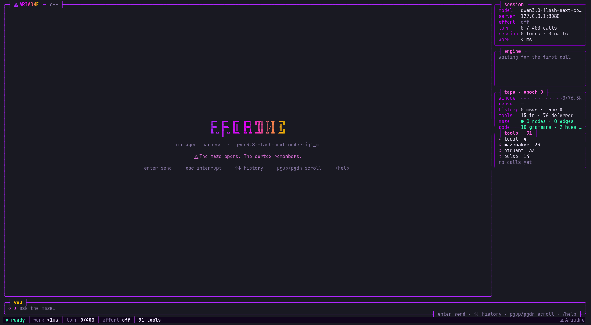
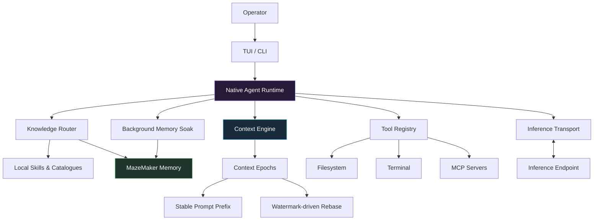
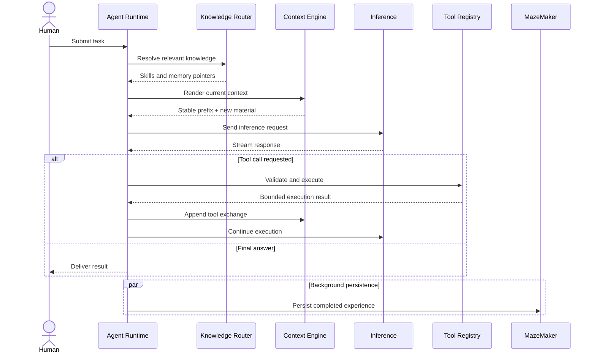
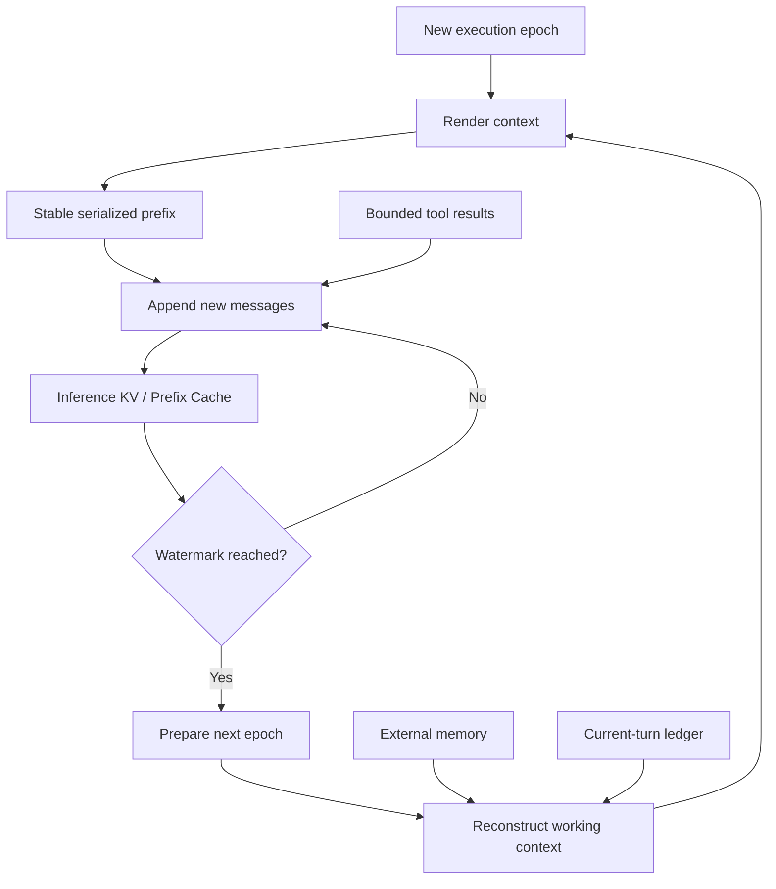
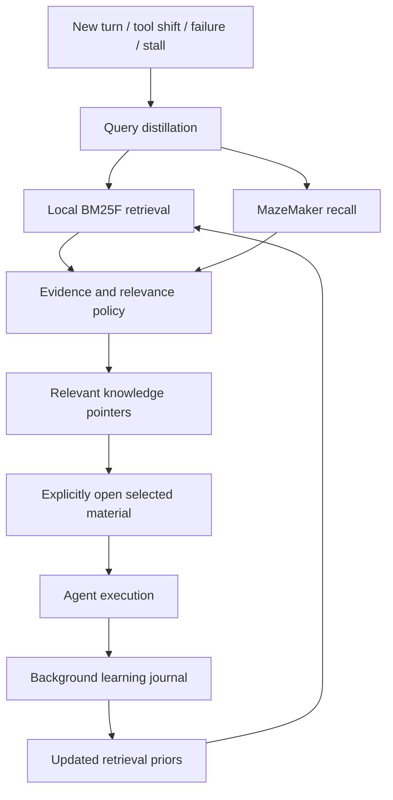
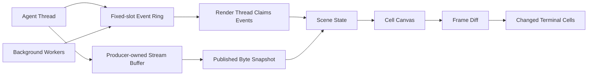
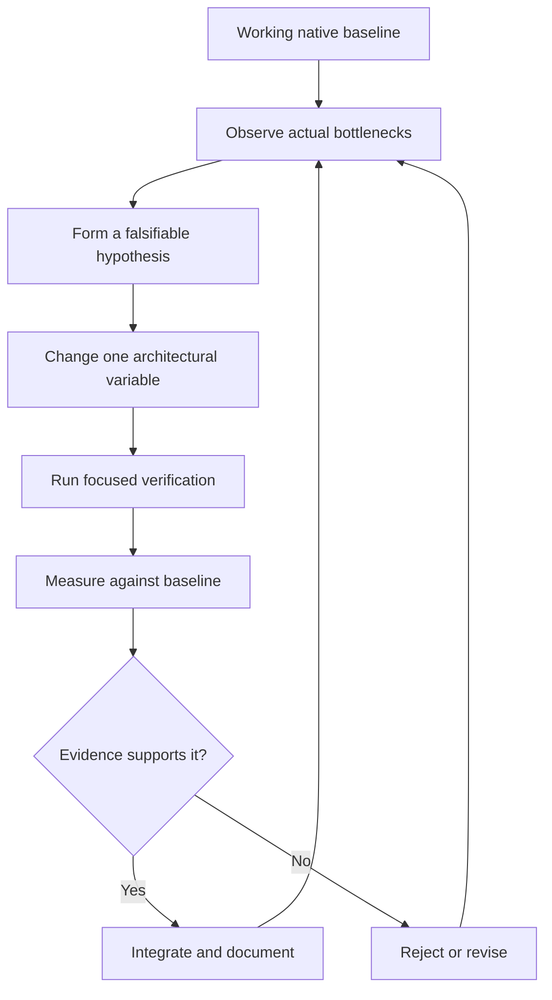

# ARIADNE
### A C++20 agent harness built to outgrow its own assumptions.

<p align="center">
  
</p>

<p align="center">
  <strong>One native binary. A live inference engine. A context architecture that knows when to forget.</strong><br>
  <em>Not another wrapper around a wrapper. A working systems substrate for agents that must survive contact with reality.</em>
</p>

<p align="center">
  <code>C++20</code> · <code>g++</code> · <code>Make</code> · <code>libcurl</code> · <code>llama.cpp-compatible API</code>
</p>

---

## What is Ariadne?

Ariadne is a native C++20 agent harness built around a deceptively simple idea:

**An agent should be more than a conversation loop surrounded by tools.**

It should be an execution system with explicit state, controlled context, persistent knowledge, predictable tool behavior, and an inference layer that can be replaced without rebuilding everything around it.

Ariadne is a native C++20 port of the Python Daedalus agent, developed into an independent systems architecture.

It combines:

- A real agent execution loop.
- Live OpenAI-compatible inference.
- Runtime-discovered Model Context Protocol (MCP) tools.
- Native filesystem and terminal operations.
- An append-oriented context tape designed for inference-prefix reuse.
- Explicit context epochs and watermark-driven rebasing.
- External long-term memory through MazeMaker.
- Knowledge routing and adaptive skill discovery.
- A concurrent, cell-diff terminal interface.
- Instrumentation across inference, context, tools, and execution.

No Python runtime is required to execute the native agent.

The model remains replaceable. The inference endpoint remains replaceable. The knowledge system remains external. The execution state remains explicit.

Ariadne is not another attempt to build the largest agent framework.

**It is an attempt to build a better execution substrate.**

## The architectural idea

Most agent frameworks start with a conversation and progressively attach more machinery to it.

Ariadne takes a different approach.

The execution loop is the center. Everything else exists to control what enters that loop, how work progresses, and what survives after a turn ends.



The architecture has four primary responsibilities:

| Component | Responsibility |
|---|---|
| Agent Runtime | Executes tasks, coordinates tools, manages turns |
| Context Engine | Controls prompt construction, reuse, and rebasing |
| Knowledge Router | Finds relevant skills and prior experience |
| Inference Transport | Communicates with replaceable model endpoints |

The TUI, filesystem, MCP integration, learning system, and external memory extend these responsibilities without replacing the central execution model.

---

## 1. The execution engine

At the heart of Ariadne is one execution loop: `Agent::run`.

It handles the complete interaction between the operator, the model, and the available tools.



The same `Agent::run` implementation powers both the interactive TUI and the headless agent executable.

There is no second orchestration framework hiding behind the interface.

The model requests a tool. The runtime validates and executes it. The result returns to the model. The execution continues until completion or an explicit stopping condition.

This separation keeps the execution model independent of the presentation layer.

### What the runtime actually does

- Streams reasoning and answer deltas.
- Validates and dispatches tool calls.
- Handles multiple execution cycles within one task.
- Limits tool output before it enters the context.
- Accounts for omitted bytes and lines.
- Applies transport retries only where replay is safe.
- Prevents an already-delivered partial answer from being blindly replayed.
- Persists completed experience asynchronously.

A failed request and a failed execution are not necessarily the same thing.

Ariadne distinguishes failures before a response begins from interruptions after output has already reached the caller.

That distinction matters when an agent is doing real work.

---

## 2. Context engineering: a managed data plane

A large context window is not a memory architecture.

It is temporary working capacity.

Ariadne's Context Engine treats context as a managed execution resource rather than an ever-growing transcript.

Its central mechanism is the **context tape**.

Instead of reconstructing the entire prompt for every request, Ariadne maintains a stable serialized prefix within an execution epoch and appends subsequent material.



### Why epochs?

An execution epoch represents a period during which the serialized context prefix remains stable.

Within that epoch:

1. The initial context is rendered.
2. New messages are appended.
3. Existing serialized content is preserved.
4. The inference backend can reuse its cached prefix.

When a configured watermark is reached, Ariadne prepares a new epoch and reconstructs the working context from explicit state.

This avoids treating the entire conversation history as indispensable working material.

### Rebase invariants

- **Render once, append thereafter.** Preserve the previous request as an exact prefix wherever the execution state permits.
- **Rebase from explicit state.** Reconstruct from the current question, rebase anchor, current-turn ledger, retrieved memory, and protected recent context.
- **No mandatory summarization dependency.** The rebase path does not require a generated conversation summary.
- **Protect active work.** Older complete tool groups yield before the newest working group.
- **Account for truncation.** Context and tool-output cuts are observable, not silent.
- **Separate memory from machine state.** Live commands describe the current environment; external memory describes previous experience.

### Prefix reuse in practice

The supplied Strata measurements using Qwen3.8-Flash-Next IQ1_M recorded:

| Experiment | Observed result |
|---|---:|
| Prompt reuse across 11 calls / 3 turns | 88% |
| First call after a prewarmed rebase | 99.1% |

These are measurements from a specific configuration, not universal guarantees.

The important architectural property is that prefix reuse is deliberately supported by the execution model rather than left entirely to chance.

---

## 3. Knowledge routing and persistent memory

Ariadne separates three things that agent frameworks frequently conflate:

- What the agent currently knows about its environment.
- What it should retrieve for the current task.
- What it has learned from previous execution.

The Knowledge Router handles the second.

MazeMaker provides the external memory system.

Local catalogues provide fast access to skills and curated knowledge.



### Local knowledge

The local catalogue combines:

- Built-in skill directories.
- Configured external skill directories.
- MazeMaker skill records.
- Curated memory cards.

Retrieval uses weighted BM25F ranking across names, tags, groups, and descriptive fields.

Rather than dumping an entire skill library into every prompt, Ariadne offers relevant pointers and opens material when needed.

### External memory

MazeMaker is the persistent knowledge layer.

Completed turns and selected reasoning are sent through a background memory-soak process. Relevant memories can subsequently be retrieved and incorporated into future execution.

This allows the working context to remain bounded without making previous experience disposable.

### Learning from execution

The background learning journal records what was offered and what was actually opened.

It can update retrieval priors and draft skills from recurring failures.

Learned skills remain traceable and probationary. Their lifecycle includes provenance and retirement through tombstones rather than silent deletion.

The result is a separation between immediate execution and longer-term knowledge formation.

**The context window is where work happens. Memory is where experience survives.**

---

## 4. Native concurrency and the rendering pipeline

Ariadne's UI is not a terminal repaint loop.

It is a separate rendering system with explicit ownership and bounded event hand-off.

The architecture separates lifecycle events from streaming bytes.



### Concurrency model

The implementation uses:

- Fixed-slot event rings.
- Atomic ownership publication.
- Producer-owned streaming buffers.
- Published-length snapshots.
- Atomic interruption signaling.
- Explicit overflow and dropped-byte accounting.

The request and rendering paths avoid conventional C++ mutex-based hand-off.

This is not a claim that the entire program is universally lock-free: the gateway uses kernel-level file locks for specific cross-process file operations.

The distinction is deliberate.

Synchronization should exist where shared state requires it, not become an automatic tax on every token.

### Measured event hand-off

A recorded 200-delta streaming experiment showed:

| Implementation | Hand-off allocations |
|---|---:|
| Previous queue path | 214 |
| Fixed-slot publication path | 0 |

The renderer also uses runtime-selected SIMD implementations for cell-diff and text-width operations:

- AVX-512
- AVX2
- Scalar fallback

OpenMP is used for sufficiently large rendering and indexing workloads, while smaller workloads remain serial.

---

## 5. The terminal interface

The TUI is a native terminal application built around a cell canvas, widgets, scene state, and frame differences.

It includes:

- Double-buffered rendering.
- Live reasoning and answer cards.
- Tool execution cards.
- UTF-8 input and line editing.
- Command history and bracketed paste.
- Mouse-wheel support.
- Terminal restoration.
- Runtime syntax highlighting.
- Theme reconciliation using WCAG relative luminance.
- Performance and context instrumentation.

### Operational commands

The interactive interface exposes commands including:

| Command | Purpose |
|---|---|
| `/context` | Inspect context state |
| `/rebase` | Trigger context reconstruction |
| `/resume` | Resume execution |
| `/plan` | Inspect planning state |
| `/learn` | Inspect learning behavior |
| `/reasoning` | Configure reasoning |
| `/effort` | Adjust reasoning effort |
| `/verbose` | Inspect execution instrumentation |

### Observability

Verbose mode exposes information that would otherwise remain invisible inside an agent framework:

- HTTP status and retry count.
- Waiting time.
- Input and output tokens.
- Cached prompt tokens.
- Context epoch.
- Tape message count.
- Ledger revision.
- Rebase history.

The goal is simple: make expensive or unexpected behavior inspectable while the system is running.

---

## 6. Inference: bring your own engine

Ariadne communicates with OpenAI-compatible inference endpoints.

The inference backend is not the agent architecture.

This means the same execution system can operate against different providers and local inference engines without changing its core tool, context, or knowledge architecture.

Supported deployment patterns include:

- Local llama.cpp servers.
- Strata-compatible endpoints.
- OpenAI-compatible remote providers.
- Other compatible inference services.

### Reasoning control

Ariadne distinguishes reasoning effort from an explicit thinking-token budget.

The configured reasoning effort is passed when selected and supported by the endpoint's reported capabilities.

Available levels are discovered rather than blindly assumed.

The supported effort ladder includes:

`off → low → medium → high → xhigh → max → ultra`

An omitted reasoning preference does not automatically impose a token cap.

An explicit thinking budget is handled separately and applies to the harness's own engine-call shape rather than being injected into arbitrary remote `/v1` requests.

### Provider routing

Ariadne also supports passing additional request fields through `model.extra`.

For example, OpenRouter provider selection can be configured without hardcoding provider-specific behavior into the transport.

```yaml
model:
  extra:
    provider:
      only:
        - baidu/fp8
      allow_fallbacks: false
```

This requests the specified provider and refuses silent fallback.

The actual responding provider must still be verified from the response metadata.

Custom fields are merged into the outgoing request, while the harness retains control over its own fundamental request fields.

---

## 7. Tools, MCP, and execution boundaries

An agent capable of taking action needs explicit boundaries.

Ariadne provides native tools and runtime MCP discovery.

| Capability | Implementation |
|---|---|
| Filesystem | Native read, write, and directory listing |
| Terminal | Child-process execution with denylist guard |
| MCP | Runtime server discovery and schema registration |
| HTTP | URL safety checks and bounded response handling |
| Tool output | Bounded before entering context |
| Secrets | Long key-like tokens redacted from returned output |
| Skills | Provenance tracking and protected learned-skill lifecycle |

### Important security distinction

**The terminal tool is guarded, not sandboxed.**

A command denylist does not provide operating-system isolation.

Filesystem restrictions and URL validation are additional protections, not substitutes for a proper security boundary.

When running untrusted workloads, use OS-level isolation, least privilege, and an appropriately restricted execution environment.

### Gateway protection

The gateway also implements device-based authentication, replay protection, and identity checks before processing protected command bodies.

Handshake nonces are tracked to prevent replay.

These mechanisms are distinct from the ordinary agent tool loop.

---

## 8. Performance: measurements over adjectives

Ariadne is developed with a preference for measurable engineering improvements rather than architectural claims based on intuition.

The following results are recorded in the supplied project measurements.

| Experiment | Recorded result |
|---|---:|
| Context prefix reuse | 88% |
| Prewarmed epoch reuse | 99.1% |
| Avoided prompt tokens in large grep-output experiment | 12,944 |
| Net token reduction in two-place file edit | 22,277 |
| UI hand-off allocations across 200 deltas | 0 |
| Previous UI hand-off allocations | 214 |
| Knowledge tokenizer throughput | 33 → 80 MB/s |
| Local skill retrieval | 2–5 µs |
| Curated memory index build | 80 → 20 ms |
| Skill index build | 112 → 40 ms |

The tokenizer measurement was recorded on a Ryzen 7 3800X setup.

The measurements depend on their respective hardware, inference endpoint, model, input, corpus, and configuration.

They should be reproduced before being used as comparative benchmarks.

**Performance is an observed property of a particular execution, not a marketing guarantee.**

---

## 9. Build and run

### Requirements

- Linux development environment.
- GCC / `g++` with C++20 support.
- GNU Make.
- libcurl development headers and library.
- OpenMP support for targets that use indexing or skill components.
- A running OpenAI-compatible inference endpoint.

### Build

```bash
make

# Individual products
make build/ariadne-agent
make build/ariadne-skills

# Run the test suites
make test

# Audit documented implementation wiring
make doc-audit
```

Build into an isolated output directory:

```bash
make BUILD=build-experiment build/ariadne-agent
```

The Makefile is the build system. Product targets compile their translation units through `g++`, with additional targets defined in `mk/*.mk`.

Warnings are treated as errors.

### Run the headless agent

```bash
# Read input from stdin
build/ariadne-agent

# Use an explicit configuration
build/ariadne-agent path/to/config.yaml -- "Explain this codebase"

# Pipe a task
printf '%s\n' 'List files in /tmp/' | build/ariadne-agent
```

### Run the interactive harness

```bash
# Initialize the Ariadne home
build/ariadne --init

# Start Ariadne
build/ariadne
```

Initialization creates the application-owned configuration and runtime directories.

Ariadne resolves its own home explicitly and refuses to silently reuse the Python Daedalus home.

### Install

```bash
make install

# Install all supported products
make install-all
```

The installer is itself a standalone C++ translation unit. It builds and installs the selected target, initializes its home, and checks that the installed binary runs.

---

## 10. Configuration

Ariadne reads its configuration from `config.yaml` in the selected application home.

A reference configuration is provided at:

`examples/ariadne/config.yaml`

Environment variables can override selected settings.

| Variable | Purpose |
|---|---|
| `DD_BASE_URL` | Override inference endpoint; must end in `/v1` |
| `DD_MODEL` | Override model identifier |
| `DD_API_KEY` | Override API key |
| `DD_WIRE_ATTEMPTS` | Maximum sends per inference call |
| `DD_WIRE_BUDGET_MS` | Maximum wall-clock retry budget |
| `DD_MAX_TURNS` | Override maximum agent turns |
| `DD_TAPE_LOG` | Enable context-tape accounting |
| `DD_FAST_LAYER` | Override fast-layer threshold for rebase testing |
| `DD_NO_SOAK=1` | Disable memory writes while retaining recall |
| `DD_TUI_MOUSE=0` | Leave mouse input to the terminal |

The default retry configuration uses a bounded retry ladder for retryable failures, including rate limiting and temporary upstream errors.

The transport respects longer upstream `Retry-After` instructions within its configured budget.

Already-delivered streaming output is not blindly replayed.

---

## 11. Verification and engineering discipline

Ariadne distinguishes code that exists in the repository from code that actually participates in a shipped execution path.

This distinction matters.

A compiled translation unit, a tested component, and a feature available through a product binary are three different things.

Run:

```bash
make test
make doc-audit
```

The test target executes the registered test binaries and reports failures across the suite.

The documentation audit derives implementation wiring and document anchors from the source tree.

Additional focused checks and measurement experiments are available in:

- `tests/`
- `bench/`
- `docs/`

For context-prefix and prompt-cache experiments, inspect `DD_TAPE_LOG` and the benchmark material.

A successful unit test or local smoke run does not imply production hardening.

---

## 12. Repository structure

```text
.
├── src/
│   ├── agent/       # Agent execution, inference transport
│   ├── context/     # Context engine, tape, epochs, rebase
│   ├── tools/       # Filesystem, terminal, MCP
│   ├── know/        # Knowledge routing and ranking
│   ├── learn/       # Learning journal and skill lifecycle
│   ├── core/        # Configuration, JSON, YAML, atomic primitives
│   ├── net/         # HTTP infrastructure
│   ├── skills/      # Skill scanning and registry
│   ├── cron/        # Scheduling
│   ├── gateway/     # Pairing, devices, gateway services
│   └── ui*.cpp      # Terminal rendering and SIMD kernels
│
├── include/dd/      # C++ headers
├── tests/           # Test suites
├── bench/           # Measurements and benchmark material
├── docs/            # Architecture and behavior documentation
├── examples/        # Reference configurations
├── installer/       # Native installer
├── mk/              # Makefile target fragments
└── build/           # Build outputs
```

The repository contains more ported code than is currently wired into product binaries.

Use `make doc-audit` to distinguish implemented and tested components from the active product surface.

---

## 13. Current boundaries

Ariadne is an evolving systems project. Its limitations should be as visible as its capabilities.

- AVX-512 kernels compile but have not been verified on AVX-512 hardware in the recorded environment.
- The terminal tool is not a sandbox.
- Some ported components are not connected to product binaries.
- Performance depends on the inference backend, model, hardware, and workload.
- The harness primarily targets OpenAI-compatible inference endpoints.
- Its optional Limbo engine integration does not include model weights or an engine build in this repository.

These are engineering boundaries, not footnotes to be hidden.

---

## 14. Where Ariadne goes next

The objective is not to accumulate features indefinitely.

It is to improve the execution substrate without compromising its invariants.

The development direction follows a continuous loop:



The priorities are:

- Expand the native execution surface only when a concrete execution path and test exist.
- Make inference, context, memory, and tool costs observable.
- Preserve replaceable inference backends.
- Keep long-term knowledge outside the volatile prompt window.
- Improve retrieval without indiscriminately increasing prompt size.
- Keep concurrency explicit and measurable.
- Make changes reversible and attributable.
- Ensure documentation never outruns implementation.

The architecture should evolve without requiring the entire system to be rebuilt around each new idea.

---

## Philosophy

> **Do not worship the frontier. Instrument it.**

A transcript is a representation, not a mind.

A context window is working capacity, not persistent memory.

A tool is not sandboxed because its command was inspected.

A retry is not safe merely because a request failed.

A ported file is not a feature until the execution path reaches it.

A benchmark is a question, not a verdict.

Ariadne is built around these distinctions.

The ambition is to make increasingly capable agents operate on increasingly sophisticated infrastructure without surrendering control over the machinery that makes them work.

Not another wrapper around a wrapper.

Not another framework that hides its own execution.

**A native agent system whose behavior can be inspected, measured, and evolved.**

---

<p align="center">
  <strong>ARIADNE</strong>
  <br>
  Native C++20 Agent Harness
  <br><br>
  <em>Build the substrate. Measure the frontier. Keep the system understandable.</em>
</p>