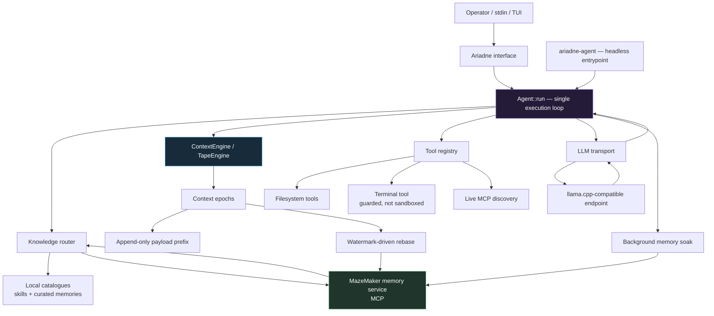
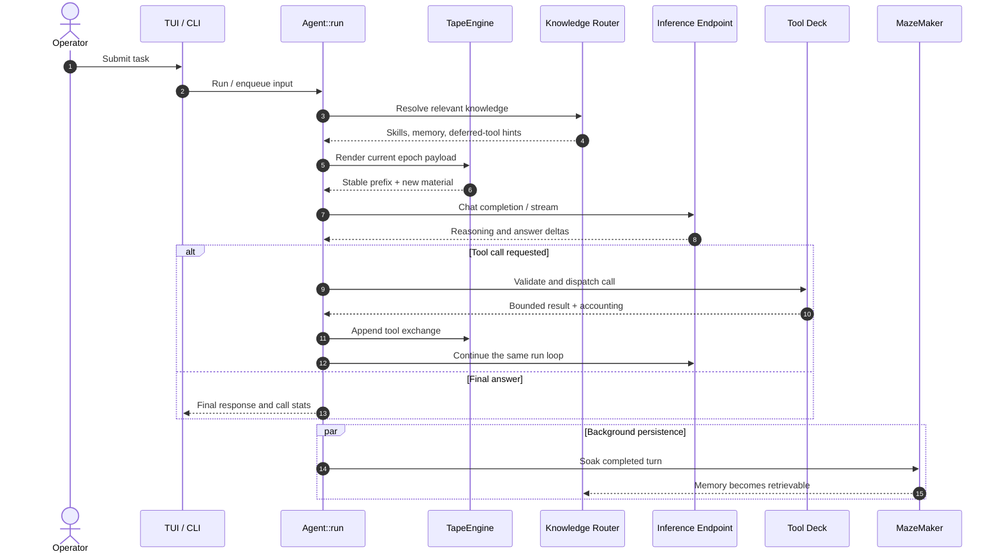
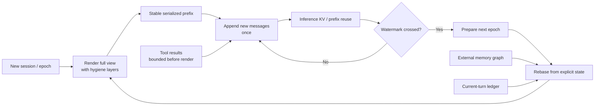
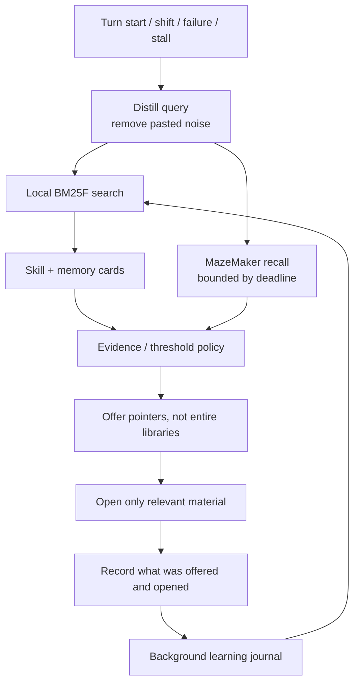
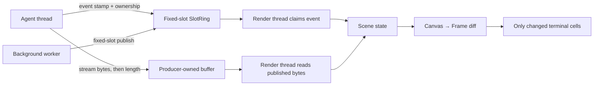
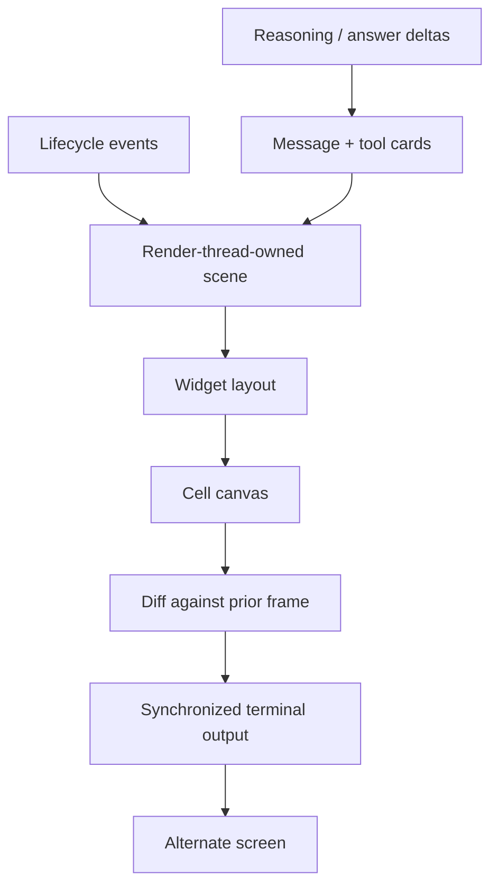
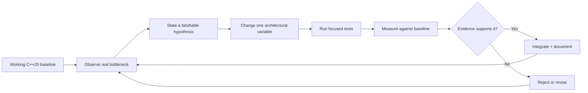

# ARIADNE
### A C++20 agent harness built to outgrow its own assumptions.

<p align="center">
  
</p>

<p align="center">
  <strong>One native binary. A live inference engine. A context architecture that knows when to forget.</strong><br>
  <em>Not another wrapper around a wrapper. A working systems substrate for agents that must survive contact with reality.</em>
</p>

<p align="center">
  <code>C++20</code> · <code>g++</code> · <code>Make</code> · <code>libcurl</code> · <code>llama.cpp-compatible API</code>
</p>

---

## The thesis

Most agent stacks treat the transcript as the mind, the prompt as the architecture, and the framework as the product.

**Ariadne treats the run loop as the executable core, the context as a managed data plane, and memory as an external system with its own lifecycle.**

The model is replaceable. The endpoint is replaceable. The terminal is replaceable. The state is not allowed to become accidental.

This repository is Ariadne, a native C++20 port of the Python Daedalus agent: a real agent loop, real tools, real filesystem effects, a live OpenAI-compatible inference endpoint, a context tape designed for prefix reuse, and a TUI that renders changes rather than repainting the world.

The guiding constraint is simple:

> Keep the working state explicit. Keep the hot path lean. Make every important claim measurable.

## Architecture at a glance



## What is real today

This is not a concept deck. The following paths are implemented in the supplied tree.

- **Native agent binary:** `build/ariadne-agent` runs the ported agent loop against a live OpenAI-compatible endpoint.
- **Real tool effects:** `read_file`, `write_file`, and `list_dir` operate on the filesystem; `run_terminal` executes child processes with a denylist guard.
- **One run loop:** the interactive TUI and headless entrypoint drive the same `Agent::run` implementation.
- **The model knows the contract.** One composed system prompt (`PromptComposer`): the
  **workflow contract** (`PromptComposer::workflow_contract` in `src/know/prompt.cpp:46`,
  toggled by `agent.contract` at `src/dd_tui.cpp:1378-1379`) — a plan before multi-step work,
  facts from running not guessing, a change is done when it was run and looked at, skills are
  guidelines you read — plus the operator's text, a retrieval contract (pointers must be opened
  before acting, never guess a path or a name, live state is a command and memory is history), a
  catalogue map, and `brief.md` if there is one. A pod's own protocol text is not pasted: it is
  offered through `mcp_servers.<name>.instructions` (`src/dd_tui.cpp:870`), which reads the
  server's instructions at `src/tools/mcp_client.cpp:304` and can be set to `harness`,
  `verbatim` or `off`.
- **Context tape:** requests reuse a stable prompt prefix within an epoch; rebases are explicit and watermark-driven.
- **External memory:** finished turns and first-sent reasoning can be soaked to MazeMaker; recall feeds the next turn.
- **Tool discovery:** enabled MCP servers are discovered at runtime and their schemas registered with the tool deck.
- **Live stream rendering:** reasoning and answer deltas stream into a double-buffered, cell-diff terminal UI.
- **Bounded tool output:** large results are cut at the source, with dropped bytes or lines accounted for and continuation hints.
- **Safer wire behavior:** URL safety checks, bounded stream sinks, and retry rules distinguish failures before output from streams that have already spoken. A turn ends at the stream's own terminator (`done()`, `include/dd/agent/chat_stream.hpp:38`, stopped in `src/agent/http_llm.cpp:135`) and not at EOF: llama-server, vLLM and OpenAI keep an SSE socket open past `data: [DONE]` to wait for the next request, so reading to EOF cost every turn the stall timeout and filed a finished answer as a stalled server. A reader that stops mid-stream is `completed` (`include/dd/agent/retry.hpp:55`), never a reason to re-send an answer the caller already holds.
- **Testable kernels:** SIMD paths are checked against scalar behavior where supported; serial and parallel output are compared for equivalence.

## Execution model



The agent does not need a second orchestration framework to become agentic. The run loop already owns the cycle: model call, tool dispatch, result, continuation, completion. The architecture around it exists to control what enters that cycle and what survives it.

## Context is a data plane, not a growing string

The transcript is not the source of truth for every future request. The tape renders a payload once per epoch, appends new material as it arrives, and rebases deliberately when the context budget approaches its watermarks.



### Design invariants

- **Render once, append thereafter.** Within an epoch, the previous request should remain an exact prefix of the next.
- **Rebase from named state.** The next epoch carries the current question, a rebase anchor, the current-turn ledger, one recall, and a protected tail.
- **No summarizer required for the rebase path.** The architecture reconstructs a compact working view from explicit state and retrieval rather than depending on a generated summary.
- **Never discard the live working group first.** When the tail must shrink, older complete tool groups yield before the newest group.
- **Count every cut.** Tool output limits and context-window cuts report what was omitted and how to continue.
- **Memory and live state are different things.** Commands describe the current machine; memory describes prior experience.
- **No thread lock on the request path.** Gateway replay and kill marks are one atomic word per bucket (`include/dd/core/mark_set.hpp:76-82`): `dd::core::MarkSet` claims a slot with `fetch_add`, sweeps from a watermark instead of scanning the table, and rebases its minute offsets under a generation instead of growing without bound. Sweeping runs where the space is needed, never on a timer. The only locks the gateway still takes are `FileLock` flocks over the store files themselves — the device store (`src/gateway/devices.cpp:140`) and the pairing file (`src/gateway/devices.cpp:165`) — they guard a file against another process, not a request against a thread.

The supplied live measurements on a Strata endpoint with Qwen3.8-Flash-Next IQ1_M showed 88% prompt-token reuse over 11 calls across three turns. In a forced-watermark test, the next epoch was prewarmed during the idle interval and its first call reused 99.1% of the prompt. These are environment-specific measurements, not universal performance guarantees.

## Knowledge routing: small local decisions, slow external recall

The knowledge router combines local catalogues with an external memory service. Local skill and curated-memory matching is designed to be cheap; the remote recall path is deadline-bound because it is the slower leg.



- Skill catalogues merge local directories, configured external directories, and MazeMaker skill rows.
- BM25F uses weighted fields for names, tags, groups, and gist; query terms are distilled before ranking.
- Triggers include turn start, shifts in the tool-call working set, failures, and repeated stalls.
- Skills and memory are opened through explicit pointers; the router does not indiscriminately paste the entire catalogue into every prompt.
- A background learning worker records observed offers and openings, updates priors, and can draft a skill from a fixed failure.
- Learned skills are probationary, traceable, and retire through tombstones rather than silent deletion.

## Concurrency without turning every token into an event

The UI separates lifecycle events from the token stream. The render thread owns scene state; producer threads publish fixed-slot events, while the streaming producer writes into its own byte buffer and publishes the committed length.



The README's recorded measurement for a 200-delta turn is zero hand-off allocations in the new path, compared with 214 in the queue it replaced. `src/` and `include/` declare no mutex, no `lock_guard` and no `condition_variable`, and instantiate none: `grep -rn 'mutex\|lock_guard\|condition_variable' src include` returns only the comments that say why there is none, never a `std::mutex`, a `lock_guard` or a `condition_variable` in code. The locks that do exist are kernel-level, per-file, and off the request path: `flock(2)` on a sidecar lock file (`include/dd/core/fslock.hpp`, and a local `FileLock` in `src/gateway/devices.cpp`) held for the whole read-modify-write of a private file — pairing codes and device minting, not request authentication. A file lock that serializes two processes around a rewrite is not a mutex guarding shared memory, and it never sits between a request and its answer. Treat these as claims about this codebase and measured setup, not as a proof that lock-free designs are universally superior.

The implementation uses fixed-slot rings, atomic ownership publication, producer-owned stream buffers, and snapshots. Ring overflow is counted; live-byte loss is counted; interruption is shared through an atomic flag that also aborts an in-flight libcurl call.

## The terminal is a renderer, not a repaint loop

The TUI uses a cell canvas and a frame diff. It owns a fixed layout, cards for messages and tool activity, live reasoning/answer streams, and explicit accounting for truncation and performance. Unchanged frames write nothing.



Highlights:

- Double-buffered `Frame` / `Widget` / `Scene` rendering.
- UTF-8 line editing, history, bracketed paste, mouse wheel, key decoding, and terminal restoration.
- Live reasoning cards and streamed answer cards without moving content below the live tail.
- `/context`, `/rebase`, `/resume`, `/plan`, `/learn`, `/reasoning`, `/effort`, `/verbose`, and related REPL commands.
- **`/verbose verbose` is the instrument.** Every call leaves a dim accounting line — `http 200
  (first 429) · 3 sends · 1.9s waited · in 4,123 (960 cached, 23%) · out 300 · epoch 7 · tape 24/24
  msgs · ledger rev 12 anchor · rebases 2 (turn start → epoch 7)` — with the response headers worth
  reading on the line under it; the status row, the engine panel and the tape panel grow the same
  numbers (`in`, `sent N`, `http`, `marks`, `ledger`, `rebase`). The rows a call leaves exist only
  at that level (`Kind::Wire`, `src/ui.cpp:1760`), so a normal run's transcript is unchanged.
- SIMD cell-diff and text-width kernels selected at runtime: AVX-512, AVX2, or scalar.
- **Code colour comes off disk, not from a compiled table.** `skills/highlight.yaml` names a
  language and which kind each word is (`skills/highlight.yaml:35-46` lists the kinds,
  `skills/highlight.yaml:93-107` the palette), read by `src/ui_grammar.cpp:273-327`; scan order
  is precedence — shipped defaults beside the binary, then skill roots, then `highlight.paths`,
  so the last file to name a language wins. A skin's own `colors.code_*` outranks a language
  file, because the skin is a claim about colour and the file is a claim about structure.
- **Every hue is measured before it lands.** `Theme::reconcile` runs WCAG relative luminance
  against the skin's own text colour and pushes an unreadable hue away from it while keeping the
  hue; it runs on the shipped palette too, since defaults are colours as well, and
  `palette_fixed` counts what moved so a reconciled palette is visible instead of silent.
- **Patch colour is scoped to the hunk's own claim.** `hunk_contract` in `src/ui.cpp:1309-1341`
  reads `@@ -a,b +c,d @@` and allows at most `b + c` rows of patch colour, so a `-` after a
  spent patch block is a bullet, not a deletion (`highlight_row` in `src/ui.cpp:1384-1480`).
- OpenMP is used for sufficiently large rendering and indexing work; small work stays serial to avoid waking threads unnecessarily.

## Tooling and trust boundaries

A tool-enabled agent is a system with side effects. The boundary needs to be explicit.

| Surface | Current behavior |
|---|---|
| Filesystem | `read_file`, `write_file`, and `list_dir` perform real I/O |
| Terminal | Executes commands with a denylist; **not a sandbox** |
| MCP | Enabled servers are discovered live; input schemas are registered |
| HTTP | URL safety checks run before clients connect |
| Streaming | Response sink is capped; a turn ends at the stream's own `done()` terminator (`include/dd/agent/chat_stream.hpp:38`) and not at EOF, because llama-server, vLLM and OpenAI hold the SSE socket open past `data: [DONE]` to wait for the next request; once deltas have been emitted, the call is not replayed |
| Retries | A refused connect, a socket cut before the response line, and the states that mean "come back" (408, 429, 500, 502, 503, 504) are re-sent while nothing has been handed out; 400/401/501/505 are verdicts and are not, nor is an interrupted call. A 429 climbs the rate ladder — three quick re-sends (250 ms, 500 ms, 1 s), then 1 s, 5 s, 15 s, 30 s, 1 min, the last rung repeating — and a server's own `Retry-After` wins over the rung whenever it is longer; a wait past the retry budget is refused with the number in the error. A reader that stops mid-stream counts as `completed` (`include/dd/agent/retry.hpp:55`) — an answer the caller already holds is never re-sent |
| Tool output | Bounded at production, with omitted bytes/lines accounted for |
| Paths | Filesystem tools reject `..` path components |
| Gateway commands | Identity before shape: `status`/`health` answer anyone, a session handshake authenticates through its own proof, and every other command reaches a device check before the body is read (`src/gateway/device_gateway.cpp:176`) — a caller outside the boundary gets `Unauthorized`, never the shape of the protocol. A handshake nonce is answered once: the replay set records it the moment the first answer goes out (`src/gateway/device_gateway.cpp:129-139`), so a captured handshake is refused as `replay` rather than minting a second session |
| Secrets | Long key-like tokens are redacted from tool output before it re-enters the prompt |
| Learned skills | Provenance is tracked; model-edited skills are protected from blind draft overwrite |

**Important:** a command denylist is not isolation. Do not expose the terminal tool to untrusted input or treat it as a security boundary. Use operating-system isolation and least privilege when running untrusted workloads.

## Build and run

### Requirements

- GCC / `g++` with C++20 support
- GNU Make
- libcurl development headers and library for `ariadne-agent`
- OpenMP support for targets that link the indexing or skill components
- A running OpenAI-compatible inference endpoint, such as a local llama.cpp server

### Build

```bash
make
make build/ariadne-skills
make build/ariadne-agent
make test
make doc-audit

# Build into a separate output tree
make BUILD=build-experiment build/ariadne-agent
```

The Makefile is the build system. Each product target compiles its translation units in one `g++` invocation; `mk/*.mk` fragments add targets. Warnings are errors.

### Run the headless agent

```bash
# Read a message from stdin; config.yaml lives beside the binary
build/ariadne-agent

# Use an explicit config and pass a message
build/ariadne-agent path/to/config.yaml -- "Explain this codebase"

# Pipe a task
printf '%s\n' 'List files in /tmp/' | build/ariadne-agent
```

### Run the full harness

```bash
build/ariadne --init
build/ariadne
```

`--init` creates the home-owned config and the runtime directories beside the selected home. The binary's home resolution is explicit; the Python Daedalus home (`~/.daedalus`) is refused rather than silently reused.

### Install

```bash
make install
make install-all
```

The installer is a standalone C++ translation unit compiled by `g++`. It re-executes itself, builds the target, installs it, seeds the home through `ariadne --init`, and checks that the installed binary runs. It deliberately avoids duplicating configuration defaults that the application itself owns.

## Configuration

The following environment variables override configuration values:

| Variable | Purpose |
|---|---|
| `DD_BASE_URL` | Override `model.base_url`; must end in `/v1` |
| `DD_MODEL` | Override `model.name` |
| `DD_API_KEY` | Override `model.api_key`; local llama.cpp setups may not need one |
| `DD_WIRE_ATTEMPTS` | Sends per LLM call (default 9, the rate ladder's length); retries only the come-back states above |
| `DD_WIRE_BUDGET_MS` | Wall clock one call may spend on sends and pauses (default 150000, the ladder's own sum); a server's `Retry-After` past it is refused rather than slept away |
| `DD_MAX_TURNS` | Override `agent.max_turns`; cap it to avoid pathological loops |
| `DD_TAPE_LOG` | Write per-call context-tape accounting |
| `DD_FAST_LAYER` | Override the fast-layer token threshold for rebase testing |
| `DD_NO_SOAK=1` | Disable memory writes while retaining recall behavior |
| `DD_TUI_MOUSE=0` | Leave mouse input to the terminal |

Configuration is resolved from the selected home and its `config.yaml`; see `examples/ariadne/config.yaml` for the shipped reference.

### Thinking: what a request tells the model

Two transports, two vocabularies. The harness never guesses what a model's dialect is: an OpenAI-shaped request carries one field, the harness's own engine calls can carry a cap, and the chat template compiled into the server has the last word on both. The default names no cap at all — `agent.thinking_budget` is 0 from the header up (`include/dd/context/endpoint.hpp:77` holds `int thinking_budget = 0`) and a config that omits the key is left uncapped by the loader (`src/dd_tui.cpp:1163` reads `cfg.has("agent.thinking_budget")`), which is what the shipped reference does as well.

| Request state | What is sent | What it does |
|---|---|---|
| `agent.reasoning_effort` empty or absent | nothing | the template's own default answers, and no cap is named either |
| `agent.reasoning_effort: off` (`none`, `false`, `disabled`) | `reasoning_effort: "none"` | thinking off; llama-server and Strata both read that spelling, and no cap is named |
| `agent.reasoning_effort: low` … `ultra` | `reasoning_effort: <level>` | the level's meaning is the template's; on the harness's own engine the cap below also applies |
| `agent.thinking_budget: N > 0` | `reasoning_budget_tokens: N` plus an instruction message, on engine calls only | caps one thinking field; a `/v1` upstream never sees it |
| `agent.thinking_budget: 0` — the default | nothing | no cap: the template decides the thinking length |

- A request that asked for no level sends no thinking field at all: `HttpLLM` sets `reasoning_effort` only when the effort callback returns a non-empty string (`src/agent/http_llm.cpp:260`), and `off` itself goes out as the string `"none"`, which llama-server and Strata read as thinking disabled (`src/dd_tui.cpp:113`). The ladder `/effort` and `/reasoning` walk is `off low medium high xhigh max ultra` (`src/dd_tui.cpp:115`).
- A request offers only what this model implements: `Endpoint::efforts()` returns the levels the chat template the server reported actually has (`src/context/endpoint.cpp:184`), and a level above that ceiling steps down through the `offered` check (`src/dd_tui.cpp:1173` uses `efforts` and `kEfforts`) until the boot note names the level that is running.
- A cap is never named for a request that did not choose a level — the shape callback is gated on `effort > 0` (`src/dd_tui.cpp:1347` calls `ep.shape` with `effort.load(...) > 0`), so neither no-preference nor `off` invites the model to think. Where a cap is named, `Endpoint::shape` writes `reasoning_budget_tokens` on engine calls (`src/context/endpoint.cpp:179`) and returns early for a remote API, which gets the OpenAI fields only (`src/context/endpoint.cpp:173-174`).

### One model, many providers: what a request says about which one answers

A model's id is not a server. A `/v1` upstream serves one model through several providers, same weights behind different servers and different quantizations, and the name a request carries cannot say which one answers. On that API the provider is a request field: `provider.only` names one, spelled as that endpoint's own model list spells it, and `provider.allow_fallbacks: false` refuses a substitute, which makes a provider other than the one asked for an error rather than a silent swap.

  The transport does not invent a grammar for that shape. What the operator writes under `model.extra` is merged into the request body before the fields the harness decides (`src/agent/http_llm.cpp:252` walks `extra.obj` first and every later `obj_set` wins the key), so `extra` can add a name this client has none of and cannot replace a `model`, a `messages` or a `stream` we chose.

| Request state | On the wire | What it does |
|---|---|---|
| no `model.extra` | nothing beyond our own fields | whoever the upstream picks answers, and the response names who did |
| `model.extra.provider.only: [baidu/fp8]` | `{"provider":{"only":["baidu/fp8"]}}` | that provider answers; the response's `provider` field is the proof, not our inference |
| `model.extra.provider.allow_fallbacks: false` | `false`, not a dropped key | a provider other than the one asked for is an error |

- `model.extra` has no default: `src/dd_tui.cpp:1335` copies it into `HttpLLM::extra` (`include/dd/agent/http_llm.hpp`) and an unset key sends nothing, which is how a local `llama-server` stays untouched by a field it has never seen.
- The contract is checked on the bytes `HttpLLM::body` builds, not on an upstream's answer: `tests/agent_wire_retry_test.cpp` asserts the merged provider object reaches the wire and that an `extra` key named `model` loses to the model we chose.
- `provider` is the one shape this key exists for today, not a second vocabulary; the key is one word for any field a `/v1` endpoint reads and this client has none of, and today only provider routing needs it. Today: a `base_url` that is a real provider's `/v1` is the only setup that can use it.

## Measurements, not mythology

The project favors repeatable checks over adjectives. The supplied README and test descriptions record the following measurements in their specific environments:

| Experiment | Recorded result |
|---|---:|
| Context tape | 88% prompt-token reuse across 11 calls / 3 turns |
| Prewarmed rebase | 99.1% reuse on the first call of the next epoch |
| Tool-output envelope | 12,944 prompt tokens per call avoided in a 1,009,800-byte grep-result experiment |
| `edit_file` tool | −22,277 net tokens on a two-place edit of a 129-line file |
| TUI event hand-off | 0 allocations across a 200-delta turn, vs. 214 in the replaced queue path |
| Knowledge tokenizer | 33 → 80 MB/s on the recorded Ryzen 7 3800X setup |
| Local skill search | 2–5 µs in the recorded catalogue setup |
| Index build | 3.7k curated memory cards: 80 → 20 ms; 467 skills: 112 → 40 ms |

These numbers are not benchmark promises. They are hypotheses with provenance: machine, model, configuration, input, and test path matter. Reproduce them before comparing them.

## Verification

```bash
make test
make doc-audit
```

The test target runs every registered test binary, continues after individual failures, and fails at the end if any test failed. The documentation audit derives the wiring list and document anchors from the tree rather than trusting a manually maintained list.

Useful focused checks mentioned in the project:

```bash
make build/dd_sink_handback_probe
build/dd_sink_handback_probe <skills-root> learned <name>
```

For a live prompt-cache or edit-tool experiment, see `bench/` and `DD_TAPE_LOG`. Test coverage and a successful local smoke run do not imply production hardening or isolation.

## Repository map

```text
.
├── src/
│   ├── agent/       # Agent run loop, wire, execution and context integration
│   ├── context/     # Context engine, tape, epochs and rebase behavior
│   ├── tools/       # Filesystem, terminal, MCP and tool helpers
│   ├── know/        # Knowledge router, catalogues and ranking
│   ├── learn/       # Learning journal and skill lifecycle
│   ├── core/        # Paths, YAML, JSON, config, home resolution, lock-free hand-off
│   ├── net/         # HTTP transport
│   ├── skills/      # Skill scanning and registry
│   ├── cron/        # Scheduling
│   ├── gateway/     # Platform registry, pairing, sticker cache
│   └── ui.cpp ui_simd.cpp ui_grammar.cpp   # the renderer: widgets, scene, canvas, frame diff, grammar
├── include/dd/      # Public/internal C++ headers
├── tests/           # Test suites
├── bench/            # Focused measurement scripts and corpora
├── docs/             # Architecture and behavior notes
├── examples/         # Reference configuration
├── installer/        # Standalone native installer
├── mk/               # Makefile target fragments
└── build/            # Build outputs
```

The source tree is larger than the currently wired product surface. The documentation audit distinguishes code that is ported and tested from code that actually reaches a product binary. That distinction is intentional: **present in the repository** does not mean **present in the execution path**.

## Known boundaries

- The AVX-512 kernels compile but have not been verified on AVX-512 hardware in the recorded environment.
- The shell tool is guarded, not jailed.
- Some ported translation units and headers are not wired into product binaries by design; use `make doc-audit` for the current measured list.
- Live measurements depend on the endpoint, model, machine, corpus, and configuration.
- The harness speaks to an OpenAI-compatible endpoint. It can also spawn and front its own engine (`--limbo`, the `dd::limbo` level), but that engine's weights and its build are not in this repository.

## Direction of travel

The stable floor is a working native harness. The frontier is the work that can now evolve without replacing that floor:

- Wire the next ported capabilities only when there is a concrete execution path and a test.
- Make tool and context costs observable before optimizing them.
- Keep the inference backend replaceable.
- Keep long-term memory outside the volatile prompt window.
- Make changes locally measurable, reversible, and attributable.
- Let the architecture evolve without allowing documentation to outrun the implementation.



## Philosophy

**Do not worship the frontier. Instrument it.**

A benchmark is a question, not a verdict. A transcript is a representation, not a mind. A ported file is not a feature until the execution path reaches it. A retry is not safe just because the request failed. A tool is not sandboxed because its command string was inspected. A context window is not memory because it is large.

The objective is not to make the README sound futuristic. It is to build systems whose behavior can be inspected, measured, and changed without losing control of the whole.

---

<sub>Ariadne · Native C++20 agent harness · Experimental systems engineering at the edge of what one person can reasonably hold in their head.</sub>
