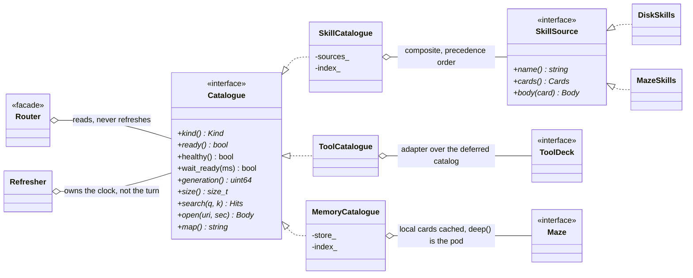
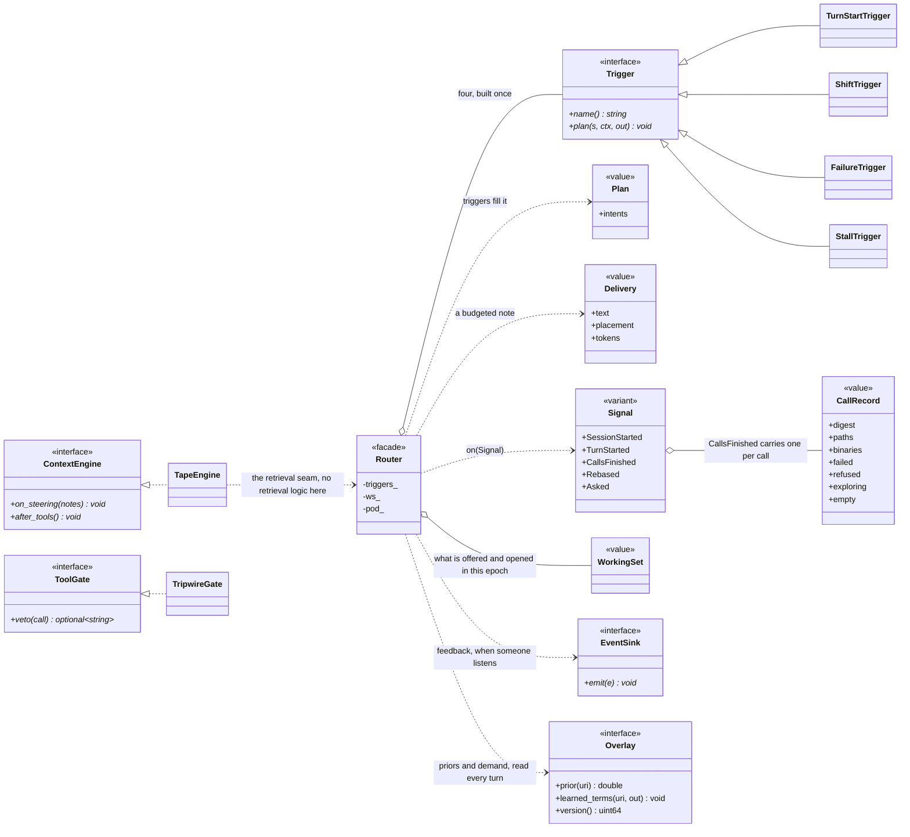

# Knowledge: one retrieval path for skills, memory and tools

Status: 2026-10-22. P0-P4 are implemented on `feat/knowledge` (worktree `~/projects/daedalus-cpp-knowledge`, on top of
`fix/window-clamp`); P5 (learning) is not started and needs a different architecture. Section 15 says what was built,
what was measured and where it deviates from this plan; 15.1 is the concurrency, SIMD and OpenMP pass that followed.

## 1. Verdict

Ariadne has retrieval parts and no retrieval policy. It looks something up at two moments
(a turn starts; the window is rebuilt), matches skills against the raw user message, and tells the
model the retrieval is "already done". While the model works (tool call after tool call, where
guessing happens) nothing looks anything up.

The plan: one `Router` decides **when**, **what** and **how** to retrieve; every body of knowledge
sits behind one `Catalogue` interface; the **harness retrieves, the model confirms by reading**.
The model is a 1-bit coder: it does not volunteer retrieval, so the harness cannot leave it to
the model's judgment (the Python Daedalus learned this: `py:agent/skill_router.py` docstring).

Orientation is oh-my-pi (omp 18.12.1, read from its docs and prompts, section 3): it keeps
retrieving first through a skills list the model MUST read from, `find` before any guessing,
rules that stay dormant until a pattern fires, and loop redirects. We take the mechanisms, not the
numbers: omp lists every discovered skill in its system prompt, which suits a large-window cloud
model; we have 498 skills and a 54.6k rebase mark.

## 2. What is wrong today (measured 2026-10-22)

| # | Finding | Evidence |
|---|---|---|
| F1 | Retrieval fires at the turn boundary (`router_->on(t)`) and on a rebase (`Rebased`); nothing looked anything up after the first tool call until W7 added the steering follow-up (`router_->on(f)`). | `src/context/engine.cpp:344`, `src/context/engine.cpp:405`, `src/context/engine.cpp:668` |
 | F2 | Closed. The system prompt once had three voices that contradicted each other: the preamble ("memory recall is only for past decisions"), the pod's ~860-token `instructions` pasted verbatim ("RECALL FIRST ... NO EXCEPTIONS", "SAVE PER TURN", `session_search`, a tool this harness does not have), and the harness paragraph ("already done ... only for what the block lacks"). Server prose is now masked, never pasted as authority: tool descriptions and the instructions text go through `SecretPolicy::ServerProse`. | `include/dd/know/prompt.hpp:6`, `src/dd_tui.cpp:932`, `src/dd_tui.cpp:977`, `src/tools/mcp_client.cpp:296` |
| F3 | Skill matching is blind and noisy. Query = the whole user message; absolute BM25 threshold 12.0 (a sum that grows with message length); ASCII-only tokenizer (ä/ö/ü split words), no stopwords, no German; tags unused; paths stripped, which also strips the strongest signal (`.../my-project/...`). About 9 ms per match (document frequencies rebuilt per call). | `tool_search.cpp:161,294`, `recall.cpp:111,148` |
| F4 | Closed: the catalogue is not read once. `ariadne` builds a merged `SkillCatalogue` through `know::make_skill_catalogue` and refreshes it — `Refresher` on a timer, `poke` after a skill is opened — so a pod that was down at launch fills in while the session runs. | `src/dd_tui.cpp:910-915,834-836,856`, `src/know/wiring.cpp` |
| F5 | Catalogue quality. 611 `skill:` rows are 498 skills + 5 notes posing as skills (`fix-i3-services-not-starting` was *offered* as one) + 1 AFE fragment. 107 names exist in both `builtin` and `local` (95 identical sha, 4 differ, 8 unknown). 101 cards have no body slices (`load()` then returns the 650-char card as "the skill"). 96 legacy cards carry raw frontmatter in the text. Only 134 cards have tags. | maze census |
| F6 | A loaded skill is a tool result: it ages out (`tool_group_ttl`, rebase) and nothing re-attaches it, so the model forgets the procedure it was following. Bodies: median 6 KB (~1.7k tokens), p90 16.8 KB (~4.7k), max 55 KB (~15k), against a rebase mark of ~54.6k. | maze census |
| F7 | Nothing is measured: no offered-to-opened counter. | |
| F8 | Closed: `build_skills` in the config schema declares `enabled`, `auto_route`, `maze`, `external_dirs`, `disabled`, and every one of them is read — the wiring layer resolves them, and `auto_route` off is a policy, not a bug. | `src/core/harness_config.hpp:289`, `src/know/wiring.cpp:22-29`, `src/know/policy.cpp:24-28` |
| F9 | The deep recall blocks the turn start: 6-8 s scoped to `skill:*`, 12-17 s for the pod's `lean`/`semantic` modes. The scope leaks (`auto:reasoning`, `skillsrc` rows come back) and one card (a security-diagnosis skill with a long description) is a hub: 6 of 8 queries. Unscoped, the top 8 held zero skills. | probes |
| F10 | Closed: `resolve_home` puts every state beside the binary and refuses `~/.daedalus`; both binaries resolve it before anything is read, and spill and the soak spool ride that root rather than the cwd. | `src/core/home.cpp:106`, `src/dd_agent_main.cpp:145-150` |

### Replay: the current matcher on real prompts

77 real prompts (29 Daedalus turns soaked in the maze, 48 operator messages) through the repo's own
`SkillIndex` against the live catalogue (503 indexed):

- 23 offers. By my reading: about 8 right, 1 arguable, about 14 wrong. Wrong ones are the
  pattern you would expect: a smoke test "write one long markdown file in a single write_file call"
  gets `discord-outbox-file-write`; a TUI-animation complaint gets `mazemaker-dream-engine` while
  `daedalus-tui-verbose-animation` sits at 11.3, just under 12; continuation summaries and pasted
  terminals go to whichever long-description skill soaks up the most common words
  (`jack-in-a-box`, `jack-in-a-box-hermes-integration`, `daedalus-single-source-of-truth`).
- At least 11 prompts had a fitting skill and got none: "deploy the site" (`mazemaker-site-ops`
  9.9), the podman-mess message (`podman-deep-dive` 11.5, `never-touch-live-pods-or-postgres` 12.0),
  the BTQuant questions, "clean sample config" (`daedalus-clean-context-setup` 9.2). Short prompts
  cannot reach 12; long ones reach it for the wrong skill.
- Semantic recall scoped to `skill:*` finds what lexical misses (podman x3, BTQuant x4,
  `daedalus-tui-verbose-animation` first) but costs ~7 s per call and has the hub problem.
  Neither leg is enough alone; the local lexical leg has to become good, and the semantic leg has to
  be asynchronous.

The labels are mine; the operator vetoes them in the corpus file (section 12). The corpus holds raw
operator prompts, so it stays out of git.

## 3. What omp does, and what we take

| omp 18.12.1 | Source | Ariadne |
|---|---|---|
| Skills as `name: description` in the system prompt; "Matching skill -> MUST read `skill://<name>` first" | `py:prompts/system/system-prompt.md` (Skills & Rules), `py:docs/skills.md` | 498 names would cost ~12.5k tokens, 23% of the window. Ship a **catalogue map** (46 groups, <= 250 tokens) plus top-k **cards per decision point**; keep the imperative. |
| `skill://`, `rule://`, `memory://`, `history://` all resolved by the one `read` verb | `py:docs/skills.md`, `py:docs/rulebook-matching-pipeline.md` s.8 | `Uri` + `Resolver`; `read_file("skill://x#sec")` works; `skill_load` stays as an alias for a weak model. |
| Rules in three buckets: always-apply (full text in the prompt), rulebook (listed, read on demand), TTSR (dormant until a pattern fires) | `py:docs/rulebook-matching-pipeline.md` s.5 | **Pins**, **Cards**, **Tripwires**. |
| TTSR: match on the model's own output, inject the rule, retry; `once` / `after-gap`; survives compaction | `py:docs/ttsr-injection-lifecycle.md` | `Tripwires` as a pre-call gate on tool arguments (no stream abort in v1): veto the call, return the rule as the result; once/after-gap; the ledger survives a rebase. |
| `find` FIRST: "NEVER guess grep/glob targets"; hits `path:range score`, below ~0.4 = weak, widen | `py:prompts/tools/find.md`, system prompt "Exploration" | `find(query, kinds)` over the catalogues with the same score semantics. Workspace code search later. |
| Loop redirects: identical call x N; repeated reasoning | `py:prompts/system/tool-call-loop-redirect.md`, `py:thinking-loop-redirect.md` | `StallTrigger`: the stop-poking-blind guard. |
| Memory: compact summary injected at session start; `recall`/`reflect`/`retain`/`learn`; "recalled rows changed" notice | `py:docs/memory.md`, `py:prompts/system/memory-recall-changes.md` | `OperatorBrief` pins in the prefix; the pod recall stays as the deep leg; `learn` becomes maze-native skills; staleness note after a rebase. |
| `intent` on every tool call ("Reading model role settings") | system prompt, Tool I/O | optional `intent` argument on the local tools: a query the model wrote itself, for free. |
| Managed skills never overwrite authored ones; lowest precedence; colliding names: winner keeps the bare name, the other is namespaced, identical copies collapse | `py:docs/skills.md` | Same rules; sha256 collapses 95 of the 107 duplicates. |
| Config in `~/.omp/agent`, `--profile`, `--config` overlay | `py:docs/config-usage.md` | We differ on purpose: beside the binary (s.10). `--config` overlay is worth keeping. |

omp does not solve our scale problem: it has no semantic skill search (its `find` is for code) and
lists every skill. That part is ours.

## 4. Principles

1. **One router decides, catalogues answer, the engine delivers.** Nothing else calls the pod to
   "recall something".
2. **Cards are local and cheap, bodies load on demand, the pod is the slow deep leg** and always
   has a deadline.
3. **Append-only.** Retrieval never edits the prefix. The system prompt changes at launch only;
   everything later is an appended item the tape renders once.
4. **The harness decides, the model confirms.** Offer ladder by confidence: silent, pointer,
   head-open, open. Measured by opened/offered.
5. **Triggers are pure.** `plan(signal, working_set) -> Plan` does no I/O: unit-testable.
6. **No lock, no queue.** Every cross-thread hand-off is one of three things: a `core::SlotRing` of fixed slots — the
   working set stays on the router thread and tool threads report opens into `opened_q_`, which refuses when full and
   counts the refusal (`opened_lost`) instead of growing — an immutable snapshot in a `core::SnapCell<T>` (wait-free
   reads, epoch reclamation), or one atomic flag or word (`done`, `cancel`, `wake`) that a thread parks on with a futex
   and never polls. `src` and `include` carry no mutex, no `lock_guard`, no `condition_variable`, and no
   `std::atomic<std::shared_ptr>`: libstdc++ spin-locks it (`is_lock_free()` is false). See 15.1.

## 5. Architecture

### 5.1 Layers

```
app      src/dd_tui.cpp                 composition root only: Home -> config -> catalogues -> Router -> engine
context  TapeEngine, Tape, Renderer consume Router::on(Signal); no retrieval logic left in the engine
know     Router . Trigger* . Distiller . WorkingSet . Deliverer . Tripwires
         Catalogue <- SkillCatalogue <- { DiskSkills, MazeSkills }   (Composite, precedence order)
                   <- MemoryCatalogue   (cards cached locally; deep() is the pod)
                   <- ToolCatalogue     (adapter over ToolDeck)
                   <- SessionCatalogue  (planned, never built: section 15)
mem      Memory (interface, header-only) <- Maze (pod over MCP) ; Soaker (writes)
core     Home, json, yaml, path
```

Dependency rule: `context -> know -> mem -> core`. `context/memory.hpp` is the seam and moves to
`mem/` untouched.

The same graph as types, with ownership drawn. `Catalogue` is the seam
(`include/dd/know/catalogue.hpp:22-34`); the composite fans out over `SkillSource` implementations in
precedence order (`include/dd/know/skills.hpp:32`), and `ToolCatalogue` sits behind the deck
(`include/dd/know/tool_catalogue.hpp:21`). Nothing below `Router` decides what is offered; `Refresher`
owns the clock, not the turn (`include/dd/know/catalogue.hpp:42`).



### 5.2 Value types

```cpp
namespace dd::know {
enum class Kind { Skill, Memory, Tool, Session, Rule };
struct Uri  { Kind kind; std::string id, path; };        // skill://name[/rel][#sec]  mem://1290233  rule://name
struct Card {                                             // what a catalogue knows without opening anything
    Uri uri; std::string title, gist, group, source;     // gist: one line, when to use it (<= 200 chars)
    std::vector<std::string> tags; size_t body_bytes = 0; double prior = 1.0;
};
struct Query { std::vector<std::pair<std::string, float>> terms; std::string text; std::vector<Kind> kinds; };
struct Hit   { Card card; double score = 0; double margin = 0; std::string why; };   // why: matched terms (TUI, tests)
struct Section { size_t offset = 0, limit = 0; };        // progressive disclosure: head first, then #2, #3
struct Body  { Uri uri; std::string text; size_t total = 0; std::string more; };
}
```

### 5.3 The catalogue contract

```cpp
class Catalogue {
public:
    virtual ~Catalogue() = default;
    virtual Kind kind() const = 0;
    virtual bool ready() const = 0;
    virtual uint64_t generation() const = 0;                          // bumps when the card set changes
    virtual size_t size() const = 0;
    virtual std::vector<Hit> search(const Query&, int k) const = 0;   // local, lock-free, never blocks, <= 1 ms
    virtual std::optional<Body> open(const Uri&, Section) = 0;        // may block; owns its deadline
    virtual std::string map() const = 0;                              // the awareness block, one line per group
    virtual void refresh() = 0;                                       // background; never throws; bumps generation
};
```

| Class | Responsibility | Replaces / reuses |
|---|---|---|
| `SkillCatalogue` | merges `SkillSource`s (precedence, sha-collapse, namespacing), owns the `Bm25f` index, `open` with sections | `SkillIndex` |
| `DiskSkills` (a `SkillSource`) | `<home>/skills`, then `skills.external_dirs` read-only; `skill://name/rel` reaches `references/` | `skills::Scanner/Registry` become its engine |
| `MazeSkills` (a `SkillSource`) | cards from `skill:*`, bodies from `skillsrc:*`; filters notes, AFE fragments, legacy cards (parses their inner frontmatter) | `SkillIndex::publish/load` |
| `MemoryCatalogue` | curated rows (`decision: bug: invariant: ops: fact: status: signal: feedback: user: reference:` ~3.7k) as cards cached in `<home>/cache`, delta-synced by id; `search` is local lexical; `deep()` is the pod recall | `Recaller::run` becomes `deep()` |
| `ToolCatalogue` | adapter over `ToolDeck`'s deferred catalog | `ToolDeck::search` |
| `SessionCatalogue` | *not built* — the soak ledger stayed in the engine (section 15) | — |
| `Bm25f` | inverted index, field weights, normalized score | `tools::rank_documents` for skills |
| `Distiller` | `Signal -> Query` (section 7) | the raw-text query |
| `Trigger` (x4) | pure `plan(Signal, PlanContext, Plan&)`; `default_triggers()` builds exactly `TurnStartTrigger`, `ShiftTrigger`, `FailureTrigger`, `StallTrigger` (`src/know/trigger.cpp:130-137`) | scattered calls in `engine.cpp` |
| `WorkingSet` | what is offered / opened / pinned in which epoch; repeat policy; `reattach()` | `in_window()` |
| `Deliverer` | renders a `Delivery` for a `Placement` within a token budget | the string building in `Recaller::run` |
| `Router` | facade: `Delivery on(Signal)`; owns the deep-leg worker and telemetry | `recaller_` + `skills_` in the engine |
| `Tripwires` | rules with a pattern; `check(ToolCall) -> vector<const Rule*>` | new |
| `PromptComposer` | one voice for the system prompt (section 9) | string concatenation in `main()` |
| `Home` | beside-the-binary paths (section 10) | five hard-coded `~/.daedalus` sites |

Patterns, because they were chosen and not sprinkled: Strategy (`Ranker`, `Trigger`, `SkillSource`),
There is no `Ranker` class: ranking is `Bm25f` behind the `Catalogue` interface, so the strategy set is
`Trigger`, `SkillSource`, and the learn side's `CreditAssigner`, `Author`, `Detector`
(`include/dd/know/trigger.hpp:32`, `include/dd/know/skills.hpp:32`). Facade (`Router`), Composite
(`SkillCatalogue` over sources), Adapter (`ToolCatalogue`), Null Object (a null `memory` in
`Router::Catalogues`, `include/dd/know/router.hpp:53`), Value Objects (`Uri`, `Card`, `Hit`, `Plan`).

### 5.4 Signals and the engine seam

```cpp
using Signal = std::variant<SessionStarted, TurnStarted /*text, anchor*/, CallsFinished /*CallRecord[]*/,
                            Rebased /*epoch*/, Asked /*query, kinds*/>;
struct CallRecord { std::string tool, intent, args, digest; std::vector<std::string> paths, binaries;
                    bool failed, refused, exploring, empty; int exit = 0; std::string error; size_t bytes = 0; };
// shipped fields (`include/dd/know/signal.hpp:34-47`): `refused` is a gate that held the call, so it is
// neither an error nor a blind look; `exploring` and `empty` are what the stall trigger counts.
```

| Engine hook (exists today) | Router call |
|---|---|
| `begin_turn` | `on(TurnStarted)` -> text for the question note |
| `on_assistant` + `on_tool_results` | collect `CallRecord`s (the engine already sees both) |
| `after_tools` | `on(CallsFinished)` -> a hidden item appended to the session |
| `rebase` / `retrieval_base` | `on(Rebased)` -> anchor blocks (the same code path as every other delivery) |
| `end_turn` | telemetry flush; `WorkingSet` turn bump |

A mid-turn note is one appended item: `Session::append(msg, hidden=true)` exists, `Renderer::one`
passes a hidden user item through unchanged (rendered once, byte-stable afterwards),
`Session::current_user()` ignores hidden items so the question never moves, and `sanitize` keeps
it. The rebase anchor already proves such an item survives the chat template. One gap: the
epoch-start collapse pass (`render.cpp`, aged tool groups) knows groups, not notes, so P3 adds
`Item::note` and collapses a note together with the group it follows.

The seam, as types. `know` hands over through two interfaces only: `agent::ContextEngine` on the loop
side (`include/dd/agent/agent.hpp:44`, implemented by `TapeEngine`, `include/dd/context/engine.hpp:72`)
and `EventSink` / `Overlay` to whoever wants feedback (`include/dd/know/event.hpp:45`,
`include/dd/know/event.hpp:63`), so `learn` can be absent without `know` knowing it is. A refusal is a
gate, not a branch: `TripwireGate` implements `agent::ToolGate` (`include/dd/know/tripwire.hpp:77`,
`include/dd/agent/agent.hpp:66-72`) and the loop asks it before a call runs.



## 6. When, what, how

| Signal | Fires when | What | How | Where / budget | Guard |
|---|---|---|---|---|---|
| Session start | process start / `/new` | pins (`user:`+`feedback:`, flagged `invariant:`: <= 800 tokens), catalogue map (<= 250) | one `get` batch, 3 s deadline, cached copy in `<home>/cache` if the pod is down | system prefix (stable, KV-cached) | built once per launch |
| Turn start | every non-trivial turn | skills + curated memory + tools | local lexical sync (< 5 ms); deep pod recall async, 1.5 s deadline; late result becomes an after-tools note | question note <= 600 tokens | skip `trivial_prompt`; ladder by confidence |
| After a tool batch (**shift**) | >= 2 new content terms (tool args, `intent`, path project/extension, binaries) not covered by this epoch's offers | skills, `invariant:` / `rule:` cards | local only | after-tools note <= 250 | not within 2 rounds of the last note; cards once per epoch |
| Failure | exit != 0 / error head, and (second failure of that tool family this turn, or the error signature matches a card) | `bug:` `invariant:` `ops:` cards, debugging skills | local, plus deep async | after-tools <= 300 | one per signature |
| Stall | identical call x2, or 3 blind explorations (`list_dir`/`read_file` misses, `ls`/`find`/`grep` with nothing new) | redirect notice + retrieval on the *question* | local + deep | after-tools <= 350 | once per turn |
| Rebase | epoch start | active skills as pointers (+ head for the one in use), pins unchanged | `WorkingSet::reattach` | anchor | tokens counted with the measured ratio |
| Model asks | `find`, `read skill://`, `mazemaker_*` | whatever it asks | always served | tool result | recorded as *opened* |
| Tripwire | a rule pattern matches a tool call's arguments | the rule text | `Tripwires::check` before execution | the vetoed call's result | `once` / `after-gap` |
| Idle | between turns | refresh catalogues (generation), warm caches | background | none | never while a turn runs |

**Budgets.** Turn-start note <= 600 tokens, whole turn <= 1,500 (2.7% of the 54.6k mark), <= 2 opened
bodies, <= 6k tokens of bodies. A skill opens head-first (<= 1.2k tokens plus a section list);
`#2`, `#3` page the rest. Strata prefills at ~500 tok/s, so 300 tokens of note cost 0.6 s: every
note has to earn it.

**Offer ladder** (calibrated thresholds, section 7): below `offer` nothing; `offer..open` a pointer
line with `read_file("skill://x")`; at or above `open` and `body_bytes <= auto_max` the head is
opened for the model in the same note. The ladder exists because the model will not follow pointers
reliably; `opened/offered` tells us when to move the thresholds.

**Demand guard** (`knowledge.refusal.*`). A card whose fold says *offered often, opened almost never*
(`offered >= offers` decayed, `conversion_lcb < floor`) stops taking slots: it is offered once every
`probe_turns`, then its window closes. The guard has two sources of the same verdict — the fold's decayed
counts, which survive a restart, and this process's own offers since the card's last open, which act the
moment the eighth refusal lands. An open by the model clears the window immediately. The invariant is
two-sided: **attention without demand is capped, and starvation is bounded** — with no probe floor the
guard would recreate the deadlock with the polarity flipped (the 180-day soak is what caught that: thirteen
cards holding 99% of the offers, seven starved). Declined slots are counted in `Router::Stats::refused`.

What the model sees:

```
<retrieval why="turn">
skill  podman-deep-dive 0.71 - rootless podman / quadlet debugging   -> read_file("skill://podman-deep-dive")
skill  never-touch-live-pods-or-postgres 0.64 - rule                 -> read_file("skill://never-touch-live-pods-or-postgres")
memory #1290233 invariant:podman-symlinks - ...                      -> read_file("mem://1290233")
</retrieval>

<retrieval why="shift: quadlet, systemctl">skill://podman-quadlet-ops 0.68 - read it before the next edit.</retrieval>

<system-notice reason="blind_exploration">3 calls found nothing (list_dir x2, read_file miss). STOP guessing paths:
find("...") or read a skill, then act.</system-notice>

[rule podman-not-docker, once] This box runs podman/quadlet, never docker. Retry with podman. (skill://podman-quadlet-ops)
```

## 7. Ranking, distillation, calibration

- **Tokenizer**: Unicode-aware lowercase; fold ä/ö/ü/ß to ae/oe/ue/ss and strip diacritics; split
  identifiers on `-_./:#` and camelCase; keep version- and error-shaped tokens whole (`0.1.45`,
  `ENOENT`, `E0433`, `HTTP 400`); EN and DE stopword lists.
- **`Bm25f`**: fields name x5, tags x3, group x1.5, gist x1; inverted index built once per
  generation; `search` touches only postings of the query terms (the current code rebuilds document
  frequencies for the whole catalogue on every call, ~9 ms).
- **Normalized score**: `score / ideal(query)` in [0,1], so a long message cannot buy a high score
  with common words. Offer when `norm >= offer` **and** `margin >= m` against the runner-up, or
  `norm >= open`. Starting values `offer 0.45, margin 0.12, open 0.70`, then **fitted on the labeled
  corpus** (grid search; the numbers ship with the test that pins them).
- **`Distiller`** turns a signal into `Query`: drops pasted blocks (> N lines of terminal output,
  continuation summaries), keeps identifiers, error codes, versions, binaries; keeps project names
  *inside paths* (`my-project`, `llama.cpp-strata`) and drops only generic path words (`src`,
  `include`, `home`); uses the model's own `intent` when present; <= 12 weighted terms.
- **Hub penalty**: `prior = 1 / (1 + log(1 + wins/expected))` from the corpus replay, so
  `jack-in-a-box` stops winning on length. Fixes the symptom; the cause is cards that say too much,
  addressed in section 8.
- **Semantic leg (optional, last)**: one pod recall scoped to `skill:*`, async, results filtered
  client-side on the label prefix (the scope leaks), fused with the lexical ranking by RRF (k=60),
  hub cards demoted. Needs a measured win over lexical-only before it ships; a local embedder is
  a separate decision.

## 8. Catalogue quality (the catalogue has to deserve the router)

Harness side (`SkillCatalogue`): collapse by sha256; keep the 4 differing duplicates as `name` and
`source/name`; never present a note or an AFE fragment as a skill; parse the frontmatter inside a
legacy card; fall back to disk for a card with no body; every skill gets a derived `gist`.
Bridge side (separate repo, not touched here): enrich each card at index time with a `Triggers:`
line (5-12 phrases in the operator's vocabulary, EN+DE) and `Tags:`; give the 101 bodyless cards
bodies or retire them; write maze-native skills with `source: maze` and their `references/`.
Both together are what lifts routing without a model call at query time (omp keeps a
`skill-descriptions.db` for the same reason: descriptions are made once, matched cheaply).

`ariadne-skills skills check` prints the census above (bodyless, duplicates, legacy, notes, no-gist) and exits
non-zero past thresholds; it runs in CI against a card snapshot.

Refresh: `generation()` plus `refresh()` on pod recovery and every 10 min while idle. "Empty for
the whole session" cannot happen again.

## 9. Prompt: one voice

`PromptComposer` assembles ordered sections, each owned by a module: Role and tool preamble;
**Retrieval contract** (from the router); Operator pins; Catalogue map; MCP notes. The pod's
`instructions` is not pasted: `mcp_servers.<name>.instructions: harness|verbatim|off`, default
`harness` for the maze server, which substitutes the contract below (the tool list stays; the
protocol steps that contradict the harness, and `session_search`, go).

Contract (RFC 2119 style as in omp, ~110 words):

```
Retrieval. The harness attaches <retrieval> notes: pointers (skills, memories, rules), never answers.
- A pointer that matches the task MUST be opened before you act on it: read_file("skill://name"), read_file("mem://id").
- NEVER guess a path, a command or a skill name. Unknown -> find(query) first.
- A <retrieval> note after a tool result means the task shifted or a call failed: read it before the next call.
- Live state (GPU, RAM, files, ports): run the command; memory is history.
- The same call twice with the same result: stop, find(), change approach.
```

The "live state first" rule from the current preamble stays; the "recall is already done" sentence
goes.

## 10. Home beside the binary

```
<dir>/ariadne          the binary
<dir>/config.yaml     config
<dir>/skills/ rules/ skins/      own content
<dir>/state/          soak-spool.jsonl, spill/<session>/
<dir>/cache/          card caches, brief
<dir>/logs/
```

`Home::resolve`: `--home DIR` > `$DD_HOME` > the directory of `/proc/self/exe` (symlinks resolved).
**Never** `~/.daedalus` implicitly. One definition: `core/home.cpp` uses it too. `DAEDALUS_HOME` is the Python
Daedalus's variable and is not read: `DD_HOME` is the one environment override. The five hard-coded sites go.

**A missing `config.yaml` refuses the start, and `DD_BASE_URL` does not exempt it** (`src/dd_tui.cpp:626`). An
endpoint names a socket, not a setting: it carries no model id, no tool set and no context budget, so the old
exemption let a start run a half-configured agent — empty model, the 8 built-in tools instead of the configured
set — and open `learn/` and `logs/` in a home nothing had ever configured, the exact state the refusal keeps out.
`--init` is the only path that writes a config; `ensure_home()` is the only path that writes folders.

- `ariadne --init` writes `config.yaml` from `examples/ariadne/config.yaml` and creates the dirs
  (`--from FILE` copies an existing config once).
- `ariadne-skills import-daedalus [--skills] [--skins]` copies from `~/.daedalus` explicitly, once. Nothing is
  shared at runtime.
- The 467-skill tree is referenced read-only through `skills.external_dirs`, or copied by the import.
- Not writable (`/usr/bin`) and no `--home`: say so in one line and exit.
- `skills.enabled`, `skills.external_dirs`, `skills.disabled`, `skills.auto_route` get wired (F8);
  new knobs live under `knowledge:` (budgets, thresholds, deadlines). `memory.prefetch_timeout_s`'s
  "turn waits on the pod" assumption is replaced by `knowledge.route.deep_ms`.

Test: run with `HOME=$(mktemp -d)` beside a copied binary in an empty directory; assert config and
dirs appear beside the binary and nothing under HOME.

## 11. Telemetry

Per signal and catalogue: offered, opened (read `skill://`, `skill_load`, auto-open), tokens,
latency, deadline misses; tripwire and stall fires. One JSON line per turn to
`<home>/logs/knowledge.jsonl`, a `know 3>1` chip (offered>opened) in the TUI. This is what moves the
ladder thresholds and what tells the curator which skills are dead.

## 12. Phases and acceptance

| Phase | Scope | Acceptance |
|---|---|---|
| **P0 Home** | `Home`, `--init`, `--home`, `import-daedalus`, state under `<home>/state`; dead knobs wired | HOME-clean test; existing suites green; the live `~/.daedalus/config.yaml` copied once with `--init --from` |
| **P1 Catalogue + ranking** | `Catalogue`, `SkillCatalogue` (Disk + Maze), `Bm25f`, `Distiller`, sha collapse, refresh; replaces `SkillIndex`; `ariadne-skills find`, `ariadne-skills skills check` | On the labeled corpus: top-3 recall >= 85% on prompts that have a skill; false offers <= 10% on prompts that have none; `search` p99 <= 1 ms; umlaut and hub cases pass; started with the pod down it still serves >= 460 skills from disk; a pod that comes up later bumps `generation` |
| **P2 Router + working set** | `Router`, `WorkingSet`, `Deliverer`, `PromptComposer`, turn-start path with deadline, rebase `reattach`, `read_file("skill://...")`, `find` | `DD_TAPE_LOG` cached/prompt ratio unchanged (>= 95%); first model call <= local + 1.5 s even with the pod at 12 s; notes <= 1,500 tokens/turn; `opened/offered` visible |
| **P3 Mid-turn** | shift / failure / stall triggers, `intent` argument | fake-Strata scenarios (the server built for the window fix, moved under `tests/`): failure -> bug card after the second failure; identical call x2 -> redirect once; a shift -> one note, none for the next 2 rounds; byte-identical prompt prefix with and without notes |
| **P4 Tripwires** | `Tripwires`, `ToolGate` hook in `Agent::execute_tool_calls`, rules from `<home>/rules` and maze `rule:` rows | `docker run` vetoed once and retried with podman; `once` honored; zero tokens added when nothing matches (prompt bytes identical) |
| **P5 Learn** | maze-native skills from solved work; usage telemetry to curation | authored skill appears in `find` on the next refresh without a restart |
| **P6 optional** | semantic leg; workspace `find` | only with a measured win over P1 |

Minimal useful cut: **P0 + P1 + the turn-start half of P2 + the prompt contract** fixes F2-F5, F8, F10
and the measured misses. P3 is the "stop poking blind" part.

Test assets: a scrubbed, labeled corpus (`tests/data/know_prompts.jsonl`, neutral prompts only) and a
card snapshot (name, group, tags, gist, sha; no bodies). The raw replay inputs stay local.

## 13. Risks and decisions

- **The model ignores pointers.** The ladder auto-opens heads at high confidence; `opened/offered`
  decides the thresholds. Calibrating on the real model needs a live Strata run: ask first.
- **Hidden user item after tool results** must behave on the Qwen template: the rebase anchor already
  does this; P3 adds a template test with `/props` chat_template.
- **Pod contention.** Soak writes, the deep leg and the prewarm all hit one serialised pod. One deep
  call in flight; none while a prewarm runs; measure before raising.
- **Strata prefill** (~500 tok/s) prices every token injected: budgets are hard caps, not hints.
- **Non-goals**: an LLM planner in the hot path (the Python `LlmPlanner`); the whole catalogue in
  the prompt; mid-stream abort (omp TTSR) in v1; pod changes; an embedding model in the harness
  before the lexical leg is fixed.
- **Decisions needed**: flat home layout (recommended) vs `<dir>/data/`; which invariants become the
  first tripwires (proposal: podman-not-docker, no Claude commit trailers, never touch live pods or
  postgres, no heavy test launches on the workstation without asking, no `commit -a` / `--no-verify`);
  who implements P0-P1 (a single agent, on `feat/knowledge`).

## 14. Reproducing the measurements

1. Cards: `mazemaker_list_by_label_prefix("skill:")` paged by 200, then `mazemaker_get` by 25 (the
   rows `SkillIndex::load_async` reads).
2. Prompts: Daedalus turns `auto:turn:dd-*` plus operator messages; first 700 chars each.
3. Replay: a 60-line driver linking `recall.cpp`, `tool_search.cpp`, `core/*` (`SkillIndex::load_rows`,
   `match`, `search`), 11 s to build, ~9 ms per search.

All read-only; no engine or harness was started for any of it.

## 15. What was built, and where it differs from the plan

| Phase | State | Where |
|---|---|---|
| P0 home | done | `core/home*`, `ariadne --init/--home`, `ariadne-skills import-daedalus`; HOME-clean verified end to end with the real binary |
| P1 catalogue + ranking | done | `know/{types,text,bm25,catalogue,skills,wiring}`, `ariadne-skills find/skills check/replay` |
| P2 router | done | `know/{router,working_set,deliver,prompt,resolver,memory_catalogue,tool_catalogue,policy}`, engine and `ariadne` wired, `SkillIndex` removed |
| P3 mid-turn | done | `know/{signal,trigger}`, `Item::note`, `intent` on the local tools |
| P4 tripwires | done | `know/tripwire`, `agent::ToolGate`, starter rules via `--init --rules` |
| P5 learn | not started | needs a different architecture |

**Measured acceptance (real prompts, real catalogue, `ariadne-skills replay`).** The P1 target in section 12 (recall >= 85% at <= 10%
false offers) was a guess before there was data, and the data does not support it for a lexical leg on terse, project-specific
prompts. 77 real prompts (33 with a fitting skill, labeled by me) against the live 568-skill catalogue:

| Rule | Offers | Right skill in the top 3 | False offers (of 44 with none) |
|---|---|---|---|
| the old matcher (BM25 on the whole message, absolute 12.0) | 23 | about 8 | about 15 wrong |
| a score threshold alone, 0.35 | 20 | 8 | 8 |
| a score threshold alone, 0.45 | 16 | 6 | 6 |
| **shipped: matched >= 2, mass >= 6.5, share >= 0.15** | 21 | **17 of 33** | **3** |
| shipped, head opened at share >= 0.25 | 12 | 9 right at 1 | |

The score alone cannot work: a single generic word ("python", "claude", "parallel") reaches 0.85 on share alone and carries no
evidence, while the right skill for a long prompt scores 0.07 because one term of twelve matched. Evidence (idf mass) and the
number of matched terms separate them. The other half of the answer is that the mid-turn signals (tool arguments, paths,
errors, the model's own `intent`) are far more specific than the user's message, so shift, failure and stall carry most of the
"stop poking blind" weight, and `find` exists for what the router does not volunteer. The semantic leg (P6) is still the way
to the missing half; its cost is the pod's 6-17 s, so it stays asynchronous.

**Deviations.**
- `Confidence` scales its evidence bar with `ln(catalogue size)`: the calibrated 6.5 is "at 568 skills"; a catalogue of twenty
  needs about 3. Without it a new user's catalogue would never offer anything.
- The maze's `skill:local:` cards are snapshots of this host's disk skills: when the disk has the skill, the disk wins and the
  snapshot is counted as `superseded` (411 of them today), not kept as a differing variant (it made 94 phantom variants).
- Legacy pointer cards (`Hermes skill:` with `Path:` and a capital-D `Description:`) read their body from that path.
- Opened skills lose their YAML frontmatter; pages are 4200 bytes (~1.2k tokens).
- `MemoryCatalogue` is local and cached in `cache/memory-cards.jsonl` (synced by id); `SessionCatalogue` was not built: the
  engine's ledger already does that job. The operator brief is `brief.md` beside the binary; deriving pins from the maze's
  `user:`/`feedback:` rows is not done.
- A deep recall that outlives its deadline is delivered with the next tool result (`Router::late`), and a question about the past
  waits for it (`knowledge.deep_recall_ms`).
- Rules are one regex on the arguments of a call, checked before it runs (no stream abort); `scope: tool:<name>` narrows it.
- The contract of 5.3 as built: `open(const Uri&)` (the page rides in the Uri), `refresh()` is blocking and the owner
  (`Refresher`) picks the thread, and `cancel(bool)` was added so `Refresher::stop()` can ask a sync in progress to stop.

### 15.1 Concurrency, SIMD and OpenMP

The first build of `dd::know` called its snapshot cells lock-free and used no SIMD or OpenMP. Both were wrong for the
operator's standing rule (atomic lock-free, no mutex unless 100% needed, OpenMP and AVX as real tools). An audit found no
mutex, but six `std::atomic<std::shared_ptr<...>>` cells (the router's `reattach_`, the skills' `places_`, `paths_` and
`snap_`, the memory and tool catalogues' `snap_`): `is_lock_free()` is 0 for it on GCC 16.2.1, because libstdc++ packs a lock
bit into the pointer and spins. They sat on the per-turn search path. What replaced them, and what else changed:

**The rule.** `src` and `include` hold no mutex, no `lock_guard`, no `condition_variable`, and no queue. A hand-off
between threads is a `core::SlotRing`, a `core::SnapCell<T>`, or one atomic flag or word. Nothing polls. The three locks
that survived the first audit are gone, each for a different reason: the retry jitter counter is one `fetch_add`
(`src/agent/retry.cpp:17`) because the tick was the only value the counter ever held, so there was no invariant a lock
could protect; the prompt-cache registry is `thread_local` (`src/agent/prompt_cache_boundary.cpp:20`) because a prefix is
registered and matched on the same thread, so the state never crosses a thread; and pairing takes the kernel's file lock
for its whole read-modify-write (`include/dd/gateway/pairing.hpp:55`) because a userspace mutex cannot cover a second ariadne
on the same home. Every `std::deque` left in a header names the one thread that owns it; the rest are hand-offs and
arrived through a ring.

**`core::SnapCell<T>`** (`include/dd/core/snap_cell.hpp`). A reader pins the current epoch (one store into its thread's
record), loads one pointer and unpins when its `Read` ends (one store): wait-free. The publisher swaps with one exchange,
retires the old snapshot under the current epoch, bumps the epoch, and frees retired snapshots whose epoch is below the
oldest epoch any reader is pinned to. It never waits for a reader: a slow reader only delays the freeing. Nested reads on a
thread pin once; thread records are leased by CAS, handed back at thread exit and never freed. A `Read` stays on its thread
and ends before its cell; one publisher at a time. Readers do not hold a pin across blocking I/O: `SkillCatalogue::open` and
the disk and maze body reads copy out what they need first. Rejected: hazard pointers (a validation loop and a record per
guard for the same result), left-right double buffering (the writer blocks on a slow reader), keeping every snapshot alive
(unbounded), `atomic<shared_ptr>` (above).

**`core::park` / `core::unpark`** (`include/dd/core/park.hpp`). A futex wait and wake on an `atomic<uint32_t>`; the kernel
compares the word with `expected` itself, so a change made just before the call is not slept through. The `Refresher` used to
poll every 50 ms forever and the router's deep-recall wait every 2 ms; both now sleep in the kernel until woken. The deep wait
still takes 20 ms slices, only to look for a user cancel; the recall landing wakes it at once. Off Linux `park` degrades to
2 ms sleeps. `Catalogue::cancel(bool)` is checked inside the memory sync's page and batch loops and the maze's skill listing,
and `Refresher::stop()` calls it: quitting no longer waits out a sync (a cold-cache first launch used to keep the process
alive about 15 s after the answer; what was fetched is kept and saved).

**`core::SlotRing<N>`** (`include/dd/core/slot_ring.hpp`). A hand-off with no mutex, no condition variable and no queue:
`N` fixed slots, each carrying one atomic word that holds the payload's stamp *and* its ownership together — 0 is held by
nobody, `s` is payload `s` published, `UINT64_MAX` is claimed. A claim is a CAS on the exact stamp the claimer read, so
exactly one thread takes each payload and a claim that loses hands back nothing rather than a payload somebody else is
holding. Two producer shapes, differing exactly where ownership is taken: `publish()` is the sole writer's path, where a
slot at 0 means that thread owns it, so it writes the payload before
the stamp appears and the release store makes the text arrive with the stamp. `publish_any()` is the several-producer
path: one `fetch_add` on a shared counter makes publish order global rather than per-thread, then a CAS takes
`free -> writing(seq)` on the slot it picked and the payload is written only once it holds it, so a half-written payload
is never readable. The claimer resets the slot after moving
the payload out, which orders the writer's next fill after that move. A scan walks slots, not publish order, so a drain
sorts the stamps it pinned (`claim_all`) and a single claim re-scans until its pick stops moving (`claim_one`). A payload
published into a slot the scan already walked belongs to the *next* claim, at a stamp older than that claim's newest, so
order across two racing claimers is measured rather than promised: 2 inversions over 4,905 one-at-a-time claims against
a writer publishing 20,000, and none inside any single drain. The turn boundary drains once per round, so it never reads
that limit. A full ring refuses the payload instead of evicting one, and the caller's backpressure decides what that
means: `ariadne` holds overflow in a list the key handler owns alone and, once anything is held, holds everything typed
after it too — a held prompt waits for the turn rather than entering it behind prompts typed later. A refusal is
counted on the ring (`refused()`) and every site reads it: `dropped_events()` and `dropped_live_bytes()` on the scene,
`opened_lost` on the router (a refused open still goes to the sink), `unledgered` on the soak, `dropped()` on the learn
sink. Rejected, measured rather than argued: the mutex plus `std::deque` this replaced (a lock on the key handler and on
the boundary), and a Vyukov MPSC queue — it allocates one node per push and grows without bound, and across a 200-delta
streamed turn the hand-off through it cost **214 allocations** against **0** on the shipped shape (`tests/ui_test.cpp`).
The boundary also needs oldest-first, not FIFO, and the idle loop sends one prompt per turn.

**SIMD** (`include/dd/know/scan.hpp`, `src/know/scan.cpp`). `classify` turns 64 bytes into bit masks (alnum, upper, lower,
space, non-ASCII) and `classify32` does one word; each exists as scalar, AVX2 and AVX-512 kernels behind `target`
attributes, picked once per process by CPUID, with `level()` and `force()` for tests, as `ui_simd` does. The tokenizer
(`src/know/text.cpp`) uses them: pass 1 finds blank-delimited words from the space mask 64 bytes at a time (trim tables, no
per-word copies); pass 2 emits a clean ASCII word with no camelCase seam straight from the text, and everything else falls to
the old per-character state machine, so the semantics are those of the old code by construction. `stem` works on views and
the stopword check is a (first byte, length) bucket table instead of a hash.

**OpenMP** (`include/dd/core/par.hpp`). `par_threads()` is `min(8, omp_get_max_threads())`, and every region sits behind a size
`if()` so small catalogues never wake a thread: `Bm25fParams::par_docs` 512, 64 skills, 512 cached memory rows. `Bm25f` builds on
all cores in three loops (each card's terms per field, each card's weight per term in field order, then 16 postings shards, each
built by one thread, the shard of a term computed once; every list stays in doc order). `DiskSkills::list` reads and hashes
skills in parallel and gathers them in order; the memory catalogue's cache is parsed in parallel. The search path looks each
query term up once, not again for every hit; its arithmetic is unchanged. `-fopenmp` is on every Makefile target that links
`bm25.cpp`, `skills.cpp` or `memory_catalogue.cpp` (an unknown pragma is an error under `-Wall -Werror`).

**Review.** An independent read of this code (a fork, read-only, with proof programs) found three real defects and four small ones; all
are fixed. (1) The catalogue map in the system prompt lacked the memory and tools lines: one refresher thread went through skills,
memory and tools in turn, and startup only waited for skills, polling every 20 ms. Now the local parts are searchable at once and the
pod is the slow leg that enriches them: `tool_cat->refresh()` runs first (it is local), `MemoryCatalogue::preload()` loads the cached
rows before any pod call, and the skill catalogue publishes its first (local, disk) source as a snapshot of its own while the maze is
still being listed, then a second one with the maze's skills. Each catalogue fed by the maze has its own refresher thread; the
skills start first and get the pod to themselves, startup sleeps on their first snapshot (`SnapCell::wait`, `Catalogue::wait_ready`:
woken by `publish()`, bounded to 4 s, no polling), and the memory sync follows. The map can therefore count the local skills only
when the maze listing is slow; the router searches the merged set as soon as it lands. (2) A use after free at exit: the
refresher thread could still be inside `ToolCatalogue::refresh()` reading the deck after the deck was gone (shown with ASAN); the
refreshers are now declared after the deck and the router, so they stop first, and the tool catalogue is not on a thread at all.
(3) A stale recall reached the next turn: `submit_deep` skipped while any older recall ran, and `on()` then delivered whatever was in
flight. A recall belongs to its turn: an older turn's is let go and a fresh one is asked, and a landed recall nobody has taken
is handed over by the next trigger instead of being replaced. Small ones: `seq_cst` on the record link and the head load in the
epoch scan (the Dekker argument had a formal gap on weak memory models, none seen on x86), `reserve` before the exchange in
`publish()` so an allocation failure cannot leak the old snapshot, and the "wait-free" wording (a thread's first read allocates its
record).

**Measured** (this box, a Ryzen 7 3800X, real data; throwaway benchmarks linking the know sources, not committed;
`OMP_NUM_THREADS=n` reproduces the scaling row):

| What | Before | After | Note |
|---|---|---|---|
| Tokenizer, 1.2 MB of card text (159k terms), one thread | 35.9 ms (33 MB/s) | 14.9 ms (80 MB/s) | same output, bit for bit |
| Memory index, 3,745 cards, parse cache + build | 79.7 ms | about 20 ms | 62 / 37 / 25 / 20 / 20 ms at 1 / 2 / 4 / 8 / 16 threads; capped at 8 |
| Skills, 467 disk cards, scan + build | 112 ms | about 40 ms | `Scanner::scan` is 31.7 ms of it, 27.4 ms of that the serial directory walk in `core::walk` |
| One search, skills / memory | 2.5 us / 5 us | 2.5 us / 5 us | unchanged |
| Local retrieval per turn (router, three catalogues) | about 0.06 ms | about 0.06 ms | the searches did not change; not re-timed end to end |

A search stays scalar: it touches a few hundred sparse postings, so there is nothing for SIMD or OpenMP to do, and saying so
beats a vector loop that wins nothing. The directory walk is syscalls in a generic helper, not compute, and was left alone.

**Verified.**
- Tokenizer: `tests/know_tokenizer_test.cpp` keeps the old per-character tokenizer verbatim as the reference and compares 560,392
  cases (structured words at every offset across the 32- and 64-byte windows, long runs around the limits, umlauts next to runs,
  UTF-8, broken bytes, 120k random texts) at every kernel level the CPU has. Three planted bugs (a dropped camelCase seam rule, a
  non-ASCII byte treated as a clean end, a missing trailing trim) are each caught at once.
- Real data: a 5,774-line dump (every card's tokens for the 467 skills and 3,745 memory rows, and the hits, scores to nine digits,
  matched terms and mass of 88 queries) has the same md5 (`6a02ce3e1461f2521a4c1b15a4d6e602`) before the work and after every step.
- Kernels: `tests/know_scan_test.cpp` checks scalar and AVX2 against a plain reference for all 256 byte values at the lengths that
  straddle a vector, 60,000 random windows, and a guard page after the text (a read past it faults).
- `Bm25f`: `tests/know_bm25_test.cpp` builds 2,600 cards serially (one shard) and in parallel at 1, 2, 4 and 8 threads and requires
  exactly equal hits (every field) and idf for 300 queries.
- `SnapCell`: `tests/core_snap_cell_test.cpp` (20,000 publishes against six readers with poisoned destructors, thread churn,
  pinned-read lifetime) is clean under ThreadSanitizer and under AddressSanitizer with UBSan. ThreadSanitizer does not understand
  libgomp, so the parallel regions are guarded by the exact-equality tests instead.
- Old against new: the committed code of the first build (old tokenizer, serial index, `atomic<shared_ptr>`) and the final code
  produce byte-identical output on the same frozen inputs: the tokens of every card of the 467 skills and 3,753 memory rows and
  the hits (scores to nine digits, matched terms, mass) of 88 queries, 5,782 lines. All eleven sanitizer builds (ASAN+UBSan for
  `snap`, `park`, `scan`, `tokenizer`, `bm25`, `router`, `know`; TSAN for `snap`, `park`, `router`, `context`) report nothing.
- `park` and the `Refresher`: `tests/core_park_test.cpp` (timeout, immediate return, wake latency, 60,000 hand-offs without a lost
  wakeup) and `test_refresher_parks` in `tests/know_router_test.cpp` (idle: no refresh, a poke is heard in under 30 ms, `stop()`
  returns in under 30 ms from a ten-minute park).
- `SlotRing`: `tests/core_slot_ring_test.cpp` (order across a wrap, `claim_one` taking the oldest stamp and naming it, a
  full ring refusing rather than overwriting, 20,000 publishes against a draining bulk claimer and a racing one-at-a-time
  claimer with nothing lost and nothing claimed twice, two claimers taking each payload exactly once at 8,000, and what a
  race leaves behind draining in publish order) reports nothing under ThreadSanitizer, which `make tsan` builds.
  Steering end to end: `test_steering_in_loop` (two prompts typed mid-turn enter the engine at the round boundary and the
  model sees them) and `build/ariadne-skills` in a tmux pane, where a prompt typed while an answer streams prints
  `◈ steered · 1 prompt entered this turn` and the answer repeats it.

**Not run.** The AVX-512 kernels (`classify_avx512`, `classify32_avx512`, and the ones in `ui_simd`) are written and compile, and
have never executed: this box has AVX2 and no AVX-512, QEMU TCG hides AVX-512 even with `-cpu max`, and Intel SDE is not installed.
They use the patterns `ui_simd` already uses (masked tail loads, `_mm512_cmple_epu8_mask`, `_bzhi_u64`). Before relying on them run
`build/dd_know_scan_tests` and `build/dd_know_tokenizer_tests` on an AVX-512 machine; each forces every level the CPU has and
prints `skip avx512 (cpu lacks it)` for the rest.

### 15.2 Test failures that are not this branch's

Seen in the full suite and reproduced with main's own binaries (built 10-21, same result), so none comes from `feat/knowledge`:
- `dd_config_tests` loads the live `~/.daedalus/config.yaml`; its `mcp_servers.pulse.description` no longer contains "arXiv".
- `dd_cc_tests` and `dd_trajectory_compressor_tests` abort with `json: eof`.
