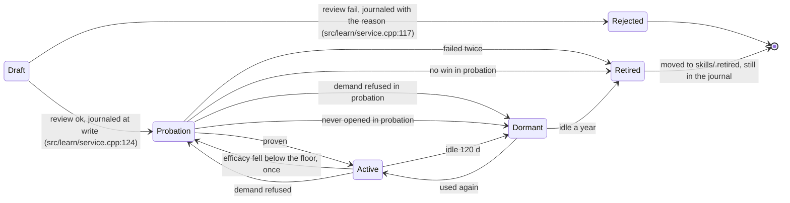

# P5 — the knowledge router learns

Status: 2026-10-22, P5.0–P5.4 built on `feat/learn` (template authoring; probation promotion and the sidekick author are not). See section 10. Builds on P0–P4 (`docs/KNOWLEDGE.md`, merged into `main` at b9cc4af).

## 1. Why P5 needs its own architecture

P0–P4 are a pure function of the present: a signal comes in, a plan runs, a note goes out, the working set forgets at the
next epoch. `knowledge.jsonl` is a write-only log. Three things follow, and they are why "add telemetry and a skill writer
to the router" does not work:

1. **No memory across sessions, and none worth keeping across weeks inside one.** A session that runs for months crosses
   hundreds of rebases. Anything learned must live outside the router's per-epoch state and outside the tape.
2. **No credit.** An offer is logged; whether it helped is never decided. `opened/offered` is conversion, not quality.
3. **No safe write path.** The catalogue is read-only at runtime. A skill the harness writes itself is a skill the model
   will trust and the router will promote, so a bad one poisons every later session.

The hot path stays as it is: lock-free, no allocation it does not already do, no learning code on the agent thread beyond
one ring publish. Learning is a second system beside the router that observes it and edits what the catalogues publish.

```
                agent thread                          learn thread (one, parked on a futex)
 Router ──events──► EventSink ──SlotRing──► Observer ─► CreditAssigner ─► Ledger (journal, durable)
   ▲                                              │                            │
   │                                              ▼                            ▼
   │                                       EpisodeRecorder ─► Detector ─► Author ─► Reviewer ─► Lifecycle
   │                                                                                                │
   └── Overlay (SnapCell snapshot: priors, learned terms) ◄── Curator ◄─────────────────────────────┘
                                                              └─► SkillSink ─► LearnedSkills (a SkillSource)
```

## 2. Principles

- **The hot path only publishes.** `EventSink::emit(Event)` is one `SlotRing::publish_any`: a stamp from one
  `fetch_add`, ownership from one CAS on the slot it picked. A full ring refuses the event and bumps `dropped()` — the
  event is never lost without a number attached. It blocks nothing and cannot grow: the slots are fixed and reused.
- **The journal is the truth; every aggregate is a fold over it.** Replaying the journal from empty gives bit-identical
  state. This is the test oracle and the crash recovery in one.
- **Bounded everything.** Every container has a cap and an eviction rule. A month-long session and a fresh one use the
  same memory to within the card count.
- **Learning only moves bounded knobs.** A card's prior stays in [0.5, 1.5]; learned terms are a capped, decayed extra
  field; nothing learned can outrank an explicit human edit. Worst case after months: ranking slightly off, never broken.
- **Nothing learned is trusted on arrival.** An authored skill is a draft, then on probation with a reduced prior, and
  only promoted by evidence. Human skills always win a collision.
- **No mutex, no polling, no LLM on the hot path** (the standing rules from KNOWLEDGE.md 15.1). The learn thread parks;
  the Overlay is a `SnapCell`; authoring runs only when the main slot is idle.

## 3. The two loops

**Feedback loop (usage -> curation).** Decides which cards are offered and found: per-card priors from measured efficacy,
and learned query terms that close the lexical gap (17 of 33 right skills reached the top 3 on the real corpus; the
misses are vocabulary the card does not share with the prompt).

**Authoring loop (solved work -> skill).** Notices an episode that went from stuck to solved, distils it into a draft
skill or bug card, vets it, and runs it through probation.

They share the ledger and the lifecycle, and nothing else, so either can be switched off (`learn.feedback`, `learn.author`).

## 4. Classes

All in `namespace dd::learn`, `include/dd/learn/`, `src/learn/`. Depends on `know` and `core`; `know` depends only on the
`EventSink` and `Overlay` interfaces, never on `learn` (dependency rule `learn -> know -> mem -> core`).

The graph as shipped. `LearnService` is the only object the composition root constructs
(`include/dd/learn/service.hpp:52`, `src/dd_tui.cpp:845`); everything else is private to it, and the two
interfaces it implements are `know`'s, not its own (`include/dd/learn/sink.hpp:24`,
`include/dd/learn/overlay.hpp:27`).

```mermaid
classDiagram
    direction LR

    class LearnService {
        <<facade>>
        +curate() void
        +author_now(turn) void
        +sink() EventSink
        +overlay() Overlay
    }
    class Ledger {
        -journal_
        -compactor_
    }
    class Journal
    class Compactor
    class Observer
    class CreditAssigner {
        <<interface>>
    }
    class RuleCredit
    class Curator
    class LearnOverlay
    class Lifecycle {
        <<table>>
        +step(stats, now, record) Changes
    }
    class EpisodeRecorder
    class Detector {
        <<interface>>
    }
    class FixedAfterFailure
    class LongSuccess
    class Pinned
    class Author {
        <<interface>>
        +author(episode) optional~Draft~
    }
    class TemplateAuthor
    class Reviewer
    class SkillSink
    class QueueSink
    class EventSink {
        <<interface>>
    }
    class Overlay {
        <<interface>>
    }

    LearnService o-- Ledger
    LearnService o-- Observer
    LearnService o-- Curator
    LearnService o-- Lifecycle
    LearnService o-- EpisodeRecorder
    LearnService o-- Author
    LearnService o-- Reviewer
    LearnService o-- SkillSink
    LearnService o-- LearnOverlay
    LearnService o-- QueueSink
    Ledger o-- Journal : the only writer of &lt;home&gt;/learn
    Ledger o-- Compactor : sealed segments into a snapshot
    Observer o-- CreditAssigner : RuleCredit
    Detector <|-- FixedAfterFailure
    Detector <|-- LongSuccess
    Detector <|-- Pinned
    Author <|-- TemplateAuthor
    QueueSink ..|> EventSink : the router's feedback side
    LearnOverlay ..|> Overlay : priors, learned terms, demand
    Curator ..> Overlay : publishes the snapshot the catalogues read
```

### 4.1 Seams into `know` (the only edits to P0–P4)

```cpp
namespace dd::know {
struct Event {                                   // a value; trivially movable, bounded (strings <= 256 B)
    enum class Type : uint8_t { Offered, OpenedByRouter, OpenedByModel, Calls, TurnEnd, Rebase, Tripwire, Stall, Shadow };
    Type type; uint64_t ts_ns; uint32_t turn, round, epoch;
    Uri uri; Placement where; std::string reason /*trigger*/, key /*error sig / intent*/, qdigest;
    float score; int matched; float mass;        // the Hit that justified it (Shadow: a near miss that was NOT offered)
    CallRecord call;                             // Type::Calls only
};
class EventSink { public: virtual ~EventSink() = default; virtual void emit(Event&&) noexcept = 0; };   // NullSink by default
class Overlay {                                  // read side: applied while a catalogue builds its snapshot
public:
    virtual ~Overlay() = default;
    virtual double prior(const Uri&) const = 0;                          // multiplies Card::prior, in [0.5, 1.5]
    virtual void   learned_terms(const Uri&, std::vector<Term>&) const = 0;   // an extra Bm25f field
    virtual uint64_t version() const = 0;                                // a catalogue rebuilds when it moved
};
}
```

`Router` gets `set_sink(std::shared_ptr<EventSink>)` and emits at the points it already logs. `Bm25f` gets a fifth field
`learned` (weight x2, below tags). `SkillCatalogue::refresh` asks the overlay for priors and terms while it builds.
`Shadow` events are the exploration channel (4.3): hits the ladder rejected, recorded so the system can learn that the
ladder was wrong, not only that its offers were.

### 4.2 Recording and durability

| Class | Responsibility |
|---|---|
| `Journal` | Append-only segment files in `<home>/learn/`, `seg-<n>.jnl`. Record = length + CRC32C + schema version + payload. `append` on the learn thread only; `fsync` batched (every 2 s or 256 records); a torn tail is truncated on open. `replay(fn)` streams all segments. Rotation at 8 MiB. |
| `Compactor` | Folds sealed segments into one `snap-<n>.dat` (the aggregates below, serialized) and deletes the segments it covers. Atomic: write temp, fsync, rename, then delete. A crash at any point leaves either the old or the new state, and replay of what remains gives the same result. |
| `Ledger` | Owns Journal + Compactor + the live aggregates. `record(Event)`; `snapshot() -> shared Stats`. The only writer of `<home>/learn/`. |
| `Stats` | Plain data: `map<Uri, CardStats>`, `map<TermCardKey, Assoc>`, episode counters. Published through a `SnapCell` to the Curator; never touched by the agent thread. |
| `Decayed` | A value-type counter `(value, t)` with a half-life; decays lazily when read or added (`v * 2^-((now-t)/hl)`). Used for every count, so stale evidence fades without a sweep. Half-lives: conversion 30 d, efficacy 90 d, associations 45 d. |

Schema changes: each record carries a version; `Journal` upgrades old records through a registered `Migration` chain on
read, never in place. An unknown *newer* version is skipped and counted (a downgraded binary does not corrupt it).

### 4.3 Credit: deciding what an offer was worth

`Observer` drains the ring on the learn thread (`claim_all`, oldest stamp first) and groups events into **Exposures**: one offer plus what happened in
its window (until the next `TurnEnd`, or 6 rounds). `CreditAssigner` is a Strategy over a window and returns an
`Outcome`; the rules are pure and unit-testable:

| Outcome | Rule | Feeds |
|---|---|---|
| `Ignored` | offered, never opened (by the model or the router) in the window | conversion down (weak) |
| `Opened` | opened by the model on its own after a pointer | conversion up |
| `Helped` | opened, and in the next 6 rounds the triggering error signature did not recur and no `stall` fired; for turn-start offers: the turn ended without a failed-call run | efficacy up |
| `Failed` | opened, and the same error signature recurred or a `stall` fired on the same topic | efficacy down |
| `Vetoed` | a tripwire held a call the card was about | the rule's card efficacy up (the rule worked) |

Two numbers per card, never mixed: **conversion** (is the offer worth making, which moves the ladder) and **efficacy**
(is the body worth reading, which moves the prior). Both are Beta posteriors over `Decayed` counts; the prior uses the
**lower credible bound** (Wilson), so a card with three lucky wins does not outrank one with fifty.

Bias controls, because a recommender that learns from its own recommendations collapses onto a few hubs (the
"jack-in-a-box" failure, but learned):
- the prior is clamped to [0.5, 1.5] and moves by at most 5% per Curator pass;
- `Shadow` events (a hit with `matched >= 2` that missed the bar) give unexposed cards a counterfactual: if a shadowed card
  would have matched an episode that was later solved by *another* route, that is evidence of a miss;
- position bias: only the top offer is credited fully; lower ones at half weight.

### 4.4 Term affinity: closing the vocabulary gap

`Affinity` learns `(query term -> card)` pairs. When an exposure is `Helped`, the distilled terms of the query that led
there, minus terms the card already contains, become candidates for that card. A pair is promoted into the `learned`
field only after it has been confirmed in at least 3 distinct episodes on at least 2 distinct days, and each card keeps
at most 24 learned terms (lowest decayed weight evicted). This is the P6 semantic leg's cheap, local, auditable cousin:
no embedder, every learned term inspectable with `ariadne-skills learn why <skill>`. If P6 ships, Affinity feeds its training pairs.

### 4.5 Authoring

```
 Calls events ─► EpisodeRecorder ─► Detector* ─► Episode ─► Author ─► Draft ─► Reviewer ─► Lifecycle ─► SkillSink
```

| Class | Responsibility |
|---|---|
| `EpisodeRecorder` | Keeps a bounded ring (last 3 turns, <= 200 CallRecords, already boiled down: no result bodies) and cuts it into `Episode`s. Evicts as it goes. |
| `Detector` (Strategy, 3 impls) | `FixedAfterFailure`: an error signature seen >= 2 times, then a call sequence after which it never recurs for 3 rounds. `LongSuccess`: >= 8 rounds on one topic ending in a turn with no failed tail. `Pinned`: the user ran `/learn` (always accepted, skips the stuck-then-solved test). Each returns a score; `Ledger` stores the episode's digest, not its content, unless a Draft is made. |
| `Author` (interface, `include/dd/learn/author.hpp:25`) | `author(const Episode&) -> optional<Draft>` (`:29`). **One impl shipped**: `TemplateAuthor` (`include/dd/learn/author.hpp:31`) — deterministic, no model; builds a **bug card** (symptom = error signature, fix = the successful call sequence with paths normalised, trigger terms from the distiller). The `SidekickAuthor` leg of this plan was never built: nothing in `src/learn/` calls a model, so drafting is a template and nothing else (section 10). |
| `Reviewer` | Gates a Draft before it exists on disk: size limits; gist length; **secret scan** (tokens, keys, `Authorization`, private paths under `$HOME` other than the project, email); **dedupe** against the catalogue (BM25 of the draft's gist against existing cards: a near-duplicate becomes an *amend proposal* to that card, not a new card); a **no-instruction rule** (the body may not contain imperatives aimed at the harness, e.g. "ignore", "always run", tool-call syntax), because a learned skill is a prompt-injection surface. Rejections are journaled with the reason. |
| `SkillSink` | Writes accepted drafts: `<home>/skills/learned/<slug>/SKILL.md` (beside the binary, never `~/.daedalus`) and, when the pod is up, `skill:learned:<slug>` + `skillsrc:learned:<slug>` in the maze. Frontmatter carries `origin: learned`, the episode digest, the date, and `state:`. Never overwrites a file without `origin: learned`. |
| `LearnedSkills` | A `SkillSource` (the existing Composite seam) that lists `skills/learned/`, with the *lowest* precedence, so a human or imported skill of the same name wins, and the `prior` of anything in `Probation` is capped at 0.7. |

### 4.6 Lifecycle



The edges above are the table in `src/learn/lifecycle.cpp:88-131`, in that order, and the labels are the `why`
strings it writes into the journal and the frontmatter (`include/dd/learn/lifecycle.hpp:48-52`), so every state
change is traceable to the rule that caused it. Thresholds are `LifecycleParams`
(`include/dd/learn/lifecycle.hpp:21-35`): `promote_wins = 3`, `promote_quiet_s = 30 d`,
`retire_failures = 2`, `probation_max_s = 60 d`, `dormant_after_s = 120 d`, `retire_after_s = 365 d`,
`demote_floor = 0.25` with `demote_evidence = 5`, `refuse_offers = 8` with `refuse_floor = 0.15`.

Two channels drive those edges, and they own different verdicts:

| channel | what it measures | what it may do |
|---|---|---|
| **efficacy** = `helped / (helped + failed)` | did the skill's content help the work | promote, demote, retire |
| **demand** = `opened / offered` | did the model read what the offer bar surfaced | demote to Probation, or send a card Dormant — **never Retired** |

A hub — a card the offer bar surfaces on almost every terminal-flavoured turn and nobody opens — has zero efficacy
draws forever, so `efficacy_lcb = 0.5` sits above the demote floor and no efficacy edge can ever fire. Demand is the
channel that sees it: `refuse_offers = 8` decayed offers with `conversion_lcb < refuse_floor = 0.15` moves an Active
card to Probation and a Probation card to Dormant. Retirement still requires efficacy draws, because refusal is
evidence about the *selector*, not about the skill: a card nobody read is not a card that failed.

`Lifecycle` is a table of `Transition{from, to, why, guard}` (`include/dd/learn/lifecycle.hpp:48-52`); guards read
`Stats` only, so the policy is data and each transition is a one-line test. It is stepped by
`LearnService::curate()`, not by the `Curator` (`src/learn/service.cpp:134-140`) — one pass per tick, at most one
transition per skill, gated by `learn.govern` (`src/dd_tui.cpp:875`). Governance keeps running when drafting is
off, or a hub the offer bar keeps surfacing sits in probation until a 60-day timer clears it
(`include/dd/learn/service.hpp:38-41`). Nothing is deleted by the harness: Retired skills move to
`skills/.retired/` and remain recoverable (the distilled-retention incident,
`bug_distilled_retention_deleted_curated`, is why).

### 4.7 Curator and budgets

`Curator::pass(now)` (`include/dd/learn/curator.hpp:33`) runs on the learn thread when idle (at most once per
10 minutes, and after a Compactor pass): folds `Stats`
into a new `OverlaySnapshot` (priors, learned terms), publishes it through a `SnapCell`, and bumps `Overlay::version()`
only when something moved by more than a threshold, so the catalogue does not rebuild on noise. Every pass also
publishes a separate `DemandSnapshot` (decayed `offered`, `opened`, conversion lower bound per card) through its own
cell: it deliberately does **not** bump `version()`, because decayed counts change every turn and a version bump would
rebuild the catalogues for evidence the ranking does not use. `Router` reads that snapshot; nothing else decides whether
a card is offered. The near-miss boost now applies only to a card nobody offered — a card offered a lot and opened never
is refused, not starved, so the curator no longer pushes a hub up while its own demand says stop. It also writes
`<home>/learn/report.md` (top movers, dormant cards, rejected drafts and why, hubs), from
`LearnService::curate()` (`src/learn/service.cpp:143`).
- The plan named a `Governor` holding budgets: at most 3 drafts per day, 40 learned skills active, 1 sidekick
  call in flight, plus the kill switches (`learn.enabled`, `learn.author`, `learn.feedback`, and a
  `<home>/learn/OFF` file checked by presence, no polling). **No `Governor` class shipped.** The budget that
  exists is one field and one counter: `ServiceOptions::max_drafts_per_day = 3`
  (`include/dd/learn/service.hpp:43`), enforced against a day-stamped counter in
  `LearnService::author_now()` (`src/learn/service.cpp:105-109`) — so the cap is per calendar day and resets
  on the first draft after midnight. The kill switches are read at construction: `learn.enabled`
  (`src/dd_tui.cpp:845`) decides whether the service starts at all, and an empty `<home>/learn/OFF` file stops
  it before the ledger is opened (`src/learn/service.cpp:14-16`); `learn.feedback` (`src/dd_tui.cpp:873`)
  decides whether the curator runs (`src/learn/service.cpp:141-144`); `learn.author` (`src/dd_tui.cpp:874`)
  decides whether drafting is allowed and is **opt-in**, unlike `learn.govern` (`src/dd_tui.cpp:875`). The
  other two caps — 40 learned skills, one sidekick call in flight — do not exist in the code: nothing counts
  learned skills and nothing calls a model.

### 4.8 The facade and the command surface

`LearnService` is the only thing `src/dd_tui.cpp` constructs: it owns the `Ledger`, the thread, the `Curator`, hands out
`sink()` and `overlay()`, and its destructor stops in the order the refreshers do (declared after the router and the
catalogues, so it stops first). `/learn` pins the last episode; `ariadne-skills learn status|why <skill>|report|forget <skill>|export`
for inspection. `forget` writes a tombstone to the journal (the fold honours it) so a deleted learning stays deleted after
replay.

## 5. Why this holds for months

| Failure over weeks | Defence |
|---|---|
| Unbounded growth | Journal rotates at 8 MiB and compacts; every map has a cap; episode ring is fixed; the hand-off is fixed-slot and refuses with a counter. |
| Crash or `kill -9` mid-append | CRC per record, torn tail truncated, compaction atomic by rename. Worst loss: the last 2 s of events. |
| Stale evidence | Every count is `Decayed`; a skill nobody opens fades to neutral by itself, no sweep. |
| Rich-get-richer / hub collapse | Prior clamped, 5% step limit, lower credible bound, shadow events, position-weighted credit. |
| Poisoned or wrong learned skill | Reviewer (secrets, dedupe, no-instruction), probation with capped prior, demotion on failure, human precedence, `forget` tombstone. |
| Clock jumps (suspend, NTP) | Time deltas are clamped to >= 0 and <= 30 d per step; ordering uses a per-journal sequence number, not wall time. |
| Binary upgraded or downgraded | Versioned records, migration chain, unknown-newer skipped. |
| Catalogue churn from learning | Overlay version bumps only past a threshold; a rebuild is the existing background refresh. |
| Pod down for days | Local disk is the source of truth for learned skills; the maze copy is written when the pod returns (idempotent by slug+rev). |
| Learning slows a turn | The agent thread does one `push`; everything else is on the learn thread; authoring only when the main slot is idle; no work at all when `OFF` exists. |
| A bug in learning | The router works with the NullSink and a null Overlay; `learn.enabled=false` returns exactly P4 behaviour (byte-identical prompts, tested). |

## 6. Concurrency and SIMD

No mutex or condition variable. `SlotRing` in, `SnapCell` out, the learn thread parks on a futex (`core::park`) woken by
the producer on empty->non-empty, and `Curator` uses a monotonic deadline for its next pass (park with timeout, not poll).
The two loops that scale with data and are worth `OpenMP`: the Curator's fold over thousands of cards, and the Reviewer's
dedupe scan, both behind `par_threads()` and a size `if()`. The CRC32C is hardware (`SSE4.2` / `_mm_crc32_u64`, with the
table fallback) chosen by CPUID like `scan.cpp`. Nothing on the search path changes.

## 7. Tests and acceptance

| Phase | Deliverable | Acceptance |
|---|---|---|
| **P5.0 Seams** | `Event`, `EventSink`, `Overlay`, the `learned` Bm25f field; router emits | With the NullSink the prompts are byte-identical to today on the 77-prompt replay; `ariadne-skills replay` numbers unchanged. |
| **P5.1 Ledger** | `Journal`, `Compactor`, `Decayed`, `Stats`, `Ledger` | Fold(replay) == live state, bit for bit; truncate the file at every byte offset: always recovers, never reads garbage; a synthetic 90-day clock (1M events) keeps memory and disk under the caps; TSAN and ASAN+UBSan clean. |
| **P5.2 Credit** | `Observer`, `CreditAssigner`, conversion and efficacy, the clamp | Table-driven tests for each outcome rule; a simulated rich-get-richer loop (shadow off) collapses onto hubs and (shadow on) does not. |
| **P5.3 Overlay** | `Curator`, `Affinity`, priors and learned terms into `SkillCatalogue` | **Held-out replay**: learn on 2/3 of the labelled corpus's episodes, test on 1/3: right-skill-in-top-3 rises from 17/33 with false offers still <= 3 of 44. If it does not, the feature does not ship. `ariadne-skills learn why` explains every learned term. |
| **P5.4 Authoring** | `EpisodeRecorder`, `Detector`s, `TemplateAuthor`, `Reviewer`, `SkillSink`, `LearnedSkills`, `Lifecycle` | A fixed-after-failure episode yields a bug card that appears in `ariadne-skills find` on the next refresh without a restart (the KNOWLEDGE.md bar); planted secrets, instructions and duplicates are each rejected; a draft never overwrites a human skill. |
| **P5.5 Sidekick author** | `SidekickAuthor` | Falls back to the template on timeout; never runs while the main slot is busy. Live check on the Friday Strata config **only after asking** (standing rule: no heavy launches on the workstation). |
| **P5.6 Soak** | Time-compressed 6-month simulation with injected crashes, clock jumps, pod outages, a downgrade | Bounded RSS and disk; no lost promotions; identical fold after every crash. |

## 8. Non-goals

An LLM in the hot path. Learning across users or machines (federation is a separate decision; the journal's export format
is stable so it can come later). Auto-deleting anything. Rewriting human skills (an amend is a proposal in the report, never
an edit). Online weight updates inside a turn.

## 9. Decisions (settled 2026-10-22)

1. Authoring is template-only first; the sidekick author waits.
2. Learned skills are ordinary skills in `<home>/skills/<category>/<name>/SKILL.md` (`origin: learned` in the frontmatter), found by `DiskSkills`; there is no `LearnedSkills` source, the Overlay caps the prior of anything on probation. Maze mirror when the pod is up.
3. Fully implicit credit: no `/good` `/bad`.
4. Probation is built last, once the rest stands.

(Original questions below, kept for the record.)

## 9a. Questions asked

1. **Authoring default**: template-only (deterministic, no model) first and sidekick later, or both from the start? Recommended: template first (P5.4), sidekick behind its own flag (P5.5).
2. **Where learned skills live**: `<home>/skills/learned/` plus a maze mirror (recommended), or the maze only?
3. **Explicit feedback**: add `/good` and `/bad` on the last offered skill as a hard label for credit (cheap, high value), or stay fully implicit?
4. **Probation threshold**: N=3 wins with 0 failures in 30 days proposed; tighter or looser?

## 10. Built

Classes live in `include/dd/learn/` and `src/learn/`; the seams into `know` are `know/event.hpp` (`Event`, `EventSink`, `Overlay`) and the router's `set_sink`, `end_turn`, `note_tripwire`.

| Part | Headers | Tests (make target) |
|---|---|---|
| Durability | `core/crc32c`, `codec`, `journal`, `compactor`, `ledger` (`Ledger::open`, `Ledger::load_readonly`) | `build/dd_learn_ledger_tests` (+ `_asan`, `_tsan`) |
| Credit | `credit` (`RuleCredit`), `observer`, `sink` (`QueueSink`), `stats` (the fold), `decayed`, `record` | `make learn-credit-test` |
| Read side | `affinity`, `curator`, `overlay` (`LearnOverlay`), `Bm25f` `learned` field, `SkillCatalogue::set_overlay` | `build/dd_learn_overlay_tests` |
| Authoring | `episode`, `detector`, `author` (`TemplateAuthor`), `reviewer`, `skill_sink` | `build/dd_learn_author_tests` |
| Service | `service` (`LearnService`, one thread, wired in `ariadne`) | `make learn-service-test` |
| Inspection | `inspect` (`status`, `why`, `export_jsonl`, `forget`), `ariadne-skills learn ...`, `/learn` | `make learn-inspect-test` |

Where things sit: the journal and snapshots in `<home>/learn/`, the curator's `report.md` beside them, learned skills in `<home>/skills/<category>/<name>/SKILL.md`, forgotten ones in `<home>/skills/.retired/` (the scanner skips that folder). `ariadne-skills learn` reads the ledger without opening it for writing, so it is safe beside a running TUI; `forget` is the one writer and should not run at the same moment as a TUI that is learning. Switches: `learn.enabled`, `learn.feedback`, `learn.author`, `learn.max_drafts_per_day`, and an empty `<home>/learn/OFF` file.

## 11. Later: forging with Mazemaker

Not built, and not to be built before the template path has run on real agent work and been bug-fixed. The direction (operator, 2026-10-22):
Mazemaker holds the whole session, conversation and reasoning, and already forges skills in the dream engine, so the better author is
the maze, not the harness. The harness stays amnesic by design; it should hand the maze the *pointer* to an episode and take back a draft.

What is already in place for it:
- `Author` is an interface (`TemplateAuthor` is one implementation). A `MazeAuthor` takes the same `Detection` and returns the same `Draft`.
- Everything after authoring is shared: `Reviewer` (secrets, duplicates, no-instruction rule), `SkillSink`, `Lifecycle`, the journal.
- The detectors and the ledger already say which episodes are worth forging and how each skill fared afterwards; the maze can use both as signal.

What it will need, and is not there yet:
- The maze turn ids of an episode on the `Detection` (the Soaker knows them; the events do not carry them today).
- A forge request the maze understands (episode ids in, a skill card out, through the dream path) and a deadline: the pod serialises calls.
- A decision on who owns the card: a `skill:learned:*` row in the maze with the disk copy as a mirror, or the other way round.
