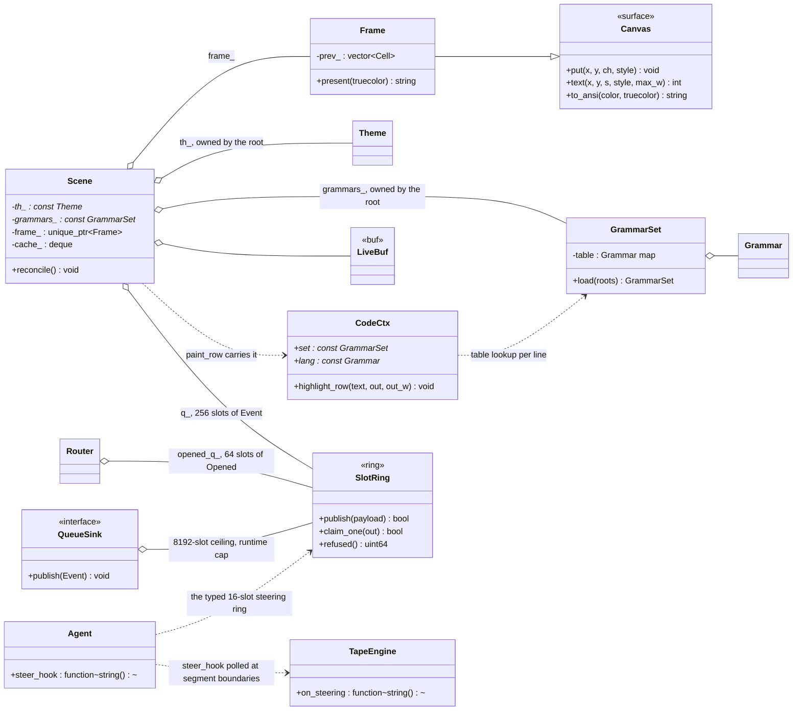

# PARITY — Ariadne against an omp-style harness

One ledger for three questions: what the harness does today, what it does not
do, and what is planned next. Every claim below was measured against the tree
on branch `fix/audit-20261024`, not read out of a README.

## Where the harness stands

| Area | Today | Evidence |
|---|---|---|
| Context tape | Append-only render, epoch per generation, rebase from retrieval at watermarks, prewarm between turns | `42ea640` is an ancestor of HEAD; `src/context/engine.cpp:232,337,383-403,420` |
| Retrieval | One `Router` at turn start, after tool batches, on failure; local BM25f catalogues + async pod leg | `src/know/trigger.cpp`, `src/know/router.cpp` |
| Skills as guidelines | Bodies read on demand: `read_file("skill://name")`, `#2`, `#all`; offer thresholds in config, not code | `src/know/prompt.cpp:30-34`, `examples/ariadne/config.yaml:71-79`, `src/know/policy.cpp:24-28` |
| Rules | Tripwires that cost nothing until a pattern fires, loaded from `./rules/*.md` and `rule:` rows, `knowledge.rules` on/off | `src/dd_tui.cpp:1089-1099` |
| Learning | `dd::learn` service: episodes, credit, priors, drafted skills, lifecycle | `docs/LEARN.md`, `src/learn/*` |
| One prompt voice | A single `PromptComposer`, the pod's protocol text is not pasted | `src/dd_tui.cpp:1063-1080` |
| Verbosity | off / normal / full: card caps lift, arguments unclipped, per-call token accounting and epoch/plan on the status row, reasoning card forced open, and a cut result states the tool's dropped count instead of the card's cap | `Verbosity` in `include/dd/ui.hpp`, `src/ui.cpp`, `/verbose` + `display.verbose` + env `DD_VERBOSE` |
| Workflow contract | One `PromptComposer::workflow_contract()` section in the composed prompt: plan before multi-step work, facts from running, done means run-and-looked, skills are guidance | `src/know/prompt.cpp:46-57`, wired at `src/dd_tui.cpp:1066-1072`, `agent.contract` toggles it |
 | Plan ledger | `todo` registered in both binaries; the ledger rides `ephemeral_system_prompt`, which the tape engine takes into a rebase's turn 0 (never the request's tail), draws as a sidebar panel, `/plan` reads it back | `src/dd_tui.cpp:1043`, `src/dd_tui.cpp:945-965`, `src/dd_tui.cpp:1292`, `src/ui.cpp:2367`, `src/dd_tui.cpp:1607`, `src/dd_agent_main.cpp:197-218` |
| Code colouring, from data | A fence names a language and a file answers it: `GrammarSet::load` walks every skill root for `highlight.yaml`, `code_color` orders the skin's own `colors.code_*` line over the language file over the palette default, a tag no file defines claims no keyword, and only a language the file declares `diff: true` colours a `-` as a deletion | `GrammarSet::load` and `code_color` in `src/ui_grammar.cpp:273-325`, `highlight_row` in `src/ui.cpp:1384-1480`, where patch colouring outside a fence is scoped to a hunk header's claim (`hunk_contract` at `src/ui.cpp:1309-1341`: `@@ -a,b +c,d @@` promises at most b + c rows and an inflated claim is capped), roots at `src/dd_tui.cpp:931-947`, defaults shipped as `skills/highlight.yaml` and copied by `installer/ariadne_install.cpp:179-186` |
| Palette contrast | Every foreground that carries glyphs is measured against the skin's ground by WCAG luminance and lifted toward the pole the ground is not, so a hue keeps its hue and only luminance gives way; a stripe whose ground is the ground it sits on drops the fill before the colour, an achromatic claim falls back to the palette's hue for that kind, and what moved is counted on the status row | `lift` and `Theme::readable` at `src/ui.cpp:746-762`, the load pass at `src/ui.cpp:856-897`, `GrammarSet::reconcile` at `src/ui_grammar.cpp:296-315`, the readout at `src/ui.cpp:2495-2500`, asserted in `tests/ui_test.cpp:1160-1230` |

## What is missing — measured, not assumed

### Tool output budget — closed at the tool layer
The bound now sits where the result is produced, not in the card. `tool_output`
(`max_bytes`, `max_lines`, `max_line_length`, `read_bytes`) resolves from the
config the process actually loaded — `tools::resolve_tool_output_from(cfg)`,
`src/tools/tool_output_limits.cpp` — into `ShellOptions::max_output` and
`FsLimits`, so `run_terminal` and `read_file` cut what they hand back before it
enters the tape. Absent or unusable values keep the numbers the tools shipped
before the section existed (8000 bytes / 2000 lines / 4000 bytes per line /
1 MiB per read), NOT `DEFAULT_MAX_*` (50000), which mirror the Python module: a
config without the section must not widen the context cost of every result
sixfold. `get_tool_output_limits()` reads the home copy and stays the parity
path; the tool layer uses the loaded config so a `--config` override counts.
A cut now names itself and how to continue: `[truncated: N of M bytes dropped]`
plus `bytes_dropped` on a terminal result, `lines_dropped` / `lines_cut` /
`next_offset` on a read, and a window that stops inside a file reports
`truncated` rather than reading as whole. Proof:
`make build/dd_tools_output_envelope_tests`.
Measured on the local server with `DD_TAPE_LOG` — two homes whose config
differs by exactly one line, same prompt, `grep -R TODO` over 1200 files
producing 1,009,800 bytes: the call that carries the result costs **9207 prompt
tokens** bounded against **22151** unbounded, and the call after it **9403**
against **22308**. That is **12,944 prompt tokens per call** for bytes the
model never reads. `level` stayed `ok` in both arms, so this is window cost,
not compaction.
@@ reply, only re-fetched by narrowing.
reply, only re-fetched by narrowing.

### Measured substrate: the ceiling, not a scorecard

Session `dd-6ae2310c` (2026-10-28, from 06:01), as the harness counters reported them and cross-checked
against `/props`. They move every turn; the ratios are the point, not the totals.

| counter | value | what it constrains |
|---|---|---|
| requests | 1,147 | — |
| prompt tokens read | 908,307 at 146 tok/s | the *uncached* part. Every token a window or a note adds lands here |
| prompt tokens reused | 45,573,645 | 98% of all prompt tokens (45,573,645 / 46,481,952); 500 of 500 requests reused part of their prompt; last request 5,310 of 10,962 |
| tokens written | 571,178 at 46.7 tok/s | decode. The long-reply side is the slow side |
| context | `/props default_generation_settings.n_ctx` = 86,192; the harness panel showed 78,690 for the same server | props is what the server was launched with, the panel is the window actually usable; `total_slots: 1` — two concurrent runs cannot share the server |
| KV cache | 8-bit, streamed: 32,768 positions per layer in VRAM, the rest in RAM | past 32,768 positions a layer reads RAM, not VRAM |
| experts in VRAM | 8,651 (8.5 GB) | the rest of the MoE is fetched from RAM per call |
| speculation | MTP drafts up to 3 tokens, prompt lookup on | the only decode accelerator on this box |
| images | off | vision is not resident |
| model / engine | `qwen3.8-flash-next-gyro-gyro-s` / v0.1.51 | — |
| GPU | RTX 4060 Ti, 16 GB — 15,707 of 16,380 MiB used | 673 MiB of headroom |
| CPU / RAM | Ryzen 7 3800X, 16 threads; 27 Gi of 31 Gi used, 3.8 Gi available | the KV spill and the RAM experts share it |

Read these as a constraint ledger, not a result to beat. Per request the model re-reads ~39.7k cached
tokens and only ~790 fresh ones, so 98% reuse is what a warm prefix costs on a box with 673 MiB of VRAM
free and 3.8 GiB of RAM free — it is the boundary, not a win. The moment a prompt goes cold the price is
146 tok/s of prefill, not the ~500 tok/s this repo previously claimed; at 46.7 tok/s decode a
1,500-token turn budget is ~32 s of writing before it pays for itself. Any second GPU consumer — a pulse
deep leg, a second slot, images switched on — pushes the KV/expert layout past 16 GB and the spill lands
in the RAM that is left, which is why the pod invariant keeps the deep leg serialised.

### What a card says about a cut result

The card renders the reply's own accounting, not its own cap. `result_facts()`
(`src/ui.cpp`) reads `output_bytes` / `bytes_dropped` from a shell reply and
`total_lines` / `lines` / `lines_dropped` / `lines_cut` / `next_offset` from a
read reply. The header carries the loss so even a folded card says it was cut
(`✓ 95ms · 1,001,800 bytes dropped`); verbose adds the reconciliation row
(`8,000 of 1,009,800 bytes reached the model · 1,001,800 dropped`) and, for a
cut read, the offset a continuation starts at
(`300 of 1,312 lines · 1,012 dropped · continue at offset 301`). The card's own
verbosity cap reports itself (`… +46 rows past the verbose cap`), so a shortened
render cannot be read as a whole result. Where the header has no room for the
number it moves to the wrapped accounting rows instead of being clipped: a
clipped `✓ done · …` is not a degraded datum, it is a lie with an ellipsis.
Asserted in `tests/ui_test.cpp` through `Scene::row_text`; seen live with
`DD_VERBOSE=verbose ariadne` on the same 1,009,800-byte grep.

### Mid-turn steering — closed
Input typed while a turn runs is folded into that turn instead of waiting for it to end. What was
typed mid-turn lands in a `core::SlotRing<16>` (`src/dd_tui.cpp:1400`) and `Agent::steer_hook`
 (`src/dd_tui.cpp:1479`) claims it with `claim_all()` — the payloads it pinned, oldest stamp first, so a
owns alone, and once anything is held everything typed after it waits too. The
loop calls at the tool-round boundary (`src/agent/agent.cpp:380`) — after the tool results are
appended, before the next request — and the prompts it returns ride as user messages.
`TapeEngine::on_steering` (`src/context/engine.cpp:648`) stamps each one with `steered`, so the
fold is a fact of the tape rather than a widget's guess: the prompt card carries
`·◈ steered · 1 prompt entered this turn` whether or not the sidebar has room for it; the
sidebar's history row counts it too, but the tape panel is a vertical budget — cards can eat the
rows that open it — so it is asserted offscreen (`tests/ui_test.cpp`) at 120x30 verbose and
120x46 normal, and the row degrades to the message count rather than clipping the fold to
"1 s…". `begin_turn` resets the count (`:317`) so the number belongs to the turn, never to the
session. A prompt
typed after the last round is left to the idle loop rather than folded mid-turn — a fold there
would silently swap the answer the operator asked for (`tests/agent_loop_test.cpp`) — and
`interrupt()` drops the fold with the tool batch. Order across the boundary is asserted
(`tests/agent_run_test.cpp`). Seen live on the same 1,009,800-byte grep at 120x30: typing
"stop. report only how many lines matched" while the tool card was up redirected the answer the
model was composing from the truncated dump — 12 lines, no further call — and the tape log
records the second call on the same epoch with its prefix cached
(`{"epoch":0,"tape":5,"history":5,"prompt":9187,"cached":4249}`).

### Hand-off without a queue — closed
The cross-thread hand-off carries no node and no lock. A lifecycle event publishes into the scene's
fixed-slot `core::SlotRing` (one `fetch_add` for the order stamp, one CAS for ownership), and a streamed
delta is not an event at all: its bytes go into a buffer its producing thread owns alone and only the
**length** word is shared, so bytes land before the length moves. Measured in the same binary as the
baseline (`tests/ui_test.cpp`, a counting allocator): across a **200-delta** streamed turn the hand-off
allocates **0** where the MPSC queue it replaced allocated **214** — one heap node per delta plus a copy —
and `SlotRing` publish/claim over 200 cycles allocates **0** too. A full ring refuses rather than growing
and every refusal is a number a test reads: **44 refused of 300** events posted (`dropped_events()`), the
router's **6 of 70** opens (`opened_lost`, each refused open still emitted to the sink), the soak's
**44 of 300** (`unledgered`, the 256 held slots still claimable), and **0** at all three on a live turn
with tools firing and a drained soak. `src` and `include` now hold no mutex, no `lock_guard`, no
`condition_variable`, and no queue (`make tsan`: no race reported).

### Sub-agents
 None in C++. `cap_delegate_calls(...,3)` (`src/agent/agent.cpp:103`, applied at `:359`) caps
delegated calls the harness cannot execute: they are recorded, never run.

### Calibration — closed: the thresholds are measured, and they moved
`ariadne-skills replay FILE [--home DIR]` (`src/cli_main.cpp`) now sweeps the offer rule's own levers
against the catalogue a home actually holds, and reports precision at rank 1 alongside
offers and misses. Run it against the live catalogue of **502 skills** with a corpus of
**1333 real operator asks** harvested from Daedalus's own session log (`bench/replay_corpus.py`):
injected harness text dropped by marker, deduplicated, and labelled *behaviourally* — the
skill ids the harness really opened after that ask. 169 asks opened a skill, 1164 opened none.

| rule | offers / 1333 | right@1 | wrong@1 | right in top-3 / 169 | false offers / 1164 | prec@1 | heads opened |
|---|---|---|---|---|---|---|---|
| shipped: matched>=2, mass>=6.5 (fitted at 568 → 6.37 here), score>=0.15, open>=0.25 | 296 | 23 | 45 | 28 | 228 | **0.34** | 101, of which 10 right |
| fitted: matched>=2, mass>=9.5 (fitted at 502), score>=0.15, open>=0.40 | 217 | 19 | 27 | 25 | 171 | **0.41** | 17, of which 4 right |

The lever table is the reason the bar moved and the term count did not. Holding score at
0.15 and sweeping `min_matched` 1→4 at every mass, precision at rank 1 stays between .32 and
.44 whatever the term count is — `matched>=4` is strictly worse (104 offers, 8 right, prec .32,
top-3 recall down from 28 to 10). Sweeping the absolute mass bar is what moves it: 6.4 → .34,
7.12 → .37, 9.5 → **.41**, 11.9 → .36. So `min_matched` stays 2, `offer_mass` goes 6.5 → 9.5,
`calibrated_at` 568 → 502 (the size it was fitted at, measured rather than guessed), and
`open_score` 0.25 → 0.40 — opening the head of a skill costs the model a whole head, and at
0.25 that bought 73 heads for 9 right ones against 17 for 4 at 0.40. `examples/ariadne/config.yaml`
carries the same three numbers, and `tests/know_router_test.cpp` re-derives `needed()` from them.

**What the numbers are not:** ground truth is behavioural, so precision is a floor, not a
fact. An ask whose right answer is `design-md` scored wrong at rank 1 when the top hit was
`daedalus-identity-update` — a plausibly adjacent card, counted against the rule. Labels also
come from the Python harness's own catalogue, which is not this one. The corpus is a snapshot
of one operator's asks, not a distribution; the curve is reproducible with the two commands in
`bench/replay_corpus.py`'s docstring, and re-running it after the catalogue changes is the
only way these numbers stay true. What the rule costs per offer is a line in the prompt; what
it saves is the `find()` call the operator would otherwise make, and the corpus cannot measure
that second half — a saved call leaves no trace in the log.

## Seam graph

The three seams the ledger above claims, as shipped objects. The highlight seam is what the Rust grammar table
becomes: roots are read once at startup and the pointers travel through the paint chain, so a render pass parses
nothing (`src/dd_tui.cpp:1023`, `include/dd/ui.hpp:217`, `include/dd/ui.hpp:354`). The hand-off seam is the same
object at both ends — a lock-free ring whose capacity is its ceiling (`include/dd/core/slot_ring.hpp:75-108`).

Anchors: `include/dd/ui.hpp:73` (Canvas), `:101` (Frame), `:206-217` (GrammarSet::load), `:234-243` (CodeCtx),
`:328` (Scene), `:425` (`SlotRing<256, Event> q_`), `:443` (LiveBuf), `:462` (the paint cache, 8 rows of 200 ms),
`include/dd/agent.hpp:99` (`steer_hook`), `include/dd/engine.hpp:86` (`on_steering`),
`include/dd/learn/sink.hpp:43`, `include/dd/know/router.hpp:120`, `include/dd/context/maze.cpp:246`
(`SlotRing<256, Job>`).

## Plan

P0 shipped on this branch (`fix/audit-20261024`, committed), in this order —
each step built, tested, then looked at:

1. **Verbose mode.** `dd::ui::Verbosity {Minimal, Normal, Verbose}`, `/verbose
   off|on|full`, `display.verbose`, env `DD_VERBOSE`. Caps lift, arguments
   unclip, per-call token accounting and the epoch/plan segments join the status
   row, the reasoning card opens every line. Verbosity is one more cache key, so
   cards re-block only when it changes; render kernels and the scene feed stayed
   untouched.
2. **Workflow contract.** `PromptComposer::workflow_contract()`, toggled by
   `agent.contract`. `README.md:76-77` names it; its old "built-in tool
   preamble" claim was drift — no such string ever existed.
3. **Plan lifecycle.** `todo` registered in both binaries; the ledger rides
   `ephemeral_system_prompt`, never the tape, so the cached prefix stays
   byte-identical and the plan survives a rebase by construction. Sidebar panel,
   `/plan`, and a count on the status row in verbose.
   *Corrected 2026-10-28:* the premise was wrong on Strata's hybrid models. The
   plan behind the payload sat in front of the engine's turn checkpoint, so every
   call fell back to a periodic one (every 16,384 tokens read) and re-read up to
   that much. The tape engine now takes the plan (`take_ephemeral`).
4. **This ledger**, plus the README line that drifted.

Also shipped here, each with its number: the wire's transient retry (proved
 against a loopback endpoint that answers 500 then 200 and never answers twice), and the same gate run against a
 keep-alive endpoint — no `Content-Length`, no `Connection: close`, socket held 4s past the last byte — which is how
 llama-server, vLLM and OpenAI actually answer: the turn has to end at `data: [DONE]`, not at EOF, so a whole answer
 arrives in under a second on exactly one send, a reader that stops mid-stream counts as `completed`
 (`include/dd/agent/chat_stream.hpp:38`, `src/agent/http_llm.cpp:92`, `include/dd/agent/retry.hpp:45`), and a
 `CURLE_WRITE_ERROR` that lands beside the terminator keeps the answer instead of re-sending it. Reading to EOF cost
 every turn the stall timeout and filed a finished answer as a stalled server; under `--serve` the held socket kept
 `busy_` set, so the first request never answered and every later one 409d behind it.
redaction of untrusted server text at the point it enters the prompt, the MCP
schema cache at boot, the duplicated inline logic folded into the ported
modules, and the doc audit that re-measures this file's citations instead of
trusting them (`make doc-audit`: 29 citations, 0 drifting). Calibration closed
on this branch — the thresholds are now measured numbers, not guesses (see
above). The tool output budget and mid-turn steering shipped here — the first
because it is what makes verbose honest about a result, the second because a
turn that cannot be redirected is a turn the operator cannot steer. The last
wave closed the hand-off: no lock, no queue, no node per delta (see above).

Next, in priority order, not promised: sub-agents.

## Verification

`make test` runs every binary in `$(TEST_BINS)` serially with
`DD_TEST_TMP=$(BUILD)/tmp` (`mk/README.md`). The Scene renders offscreen, so
visual checks are assertions on `Scene::row_text(y)` (`tests/ui_test.cpp:170-173`)
— a card's rows are read back as plain text, which is the same frame a tty
would blit.
